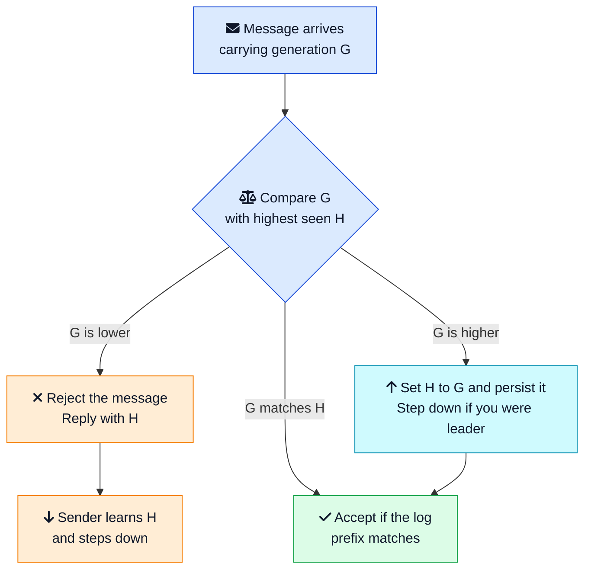
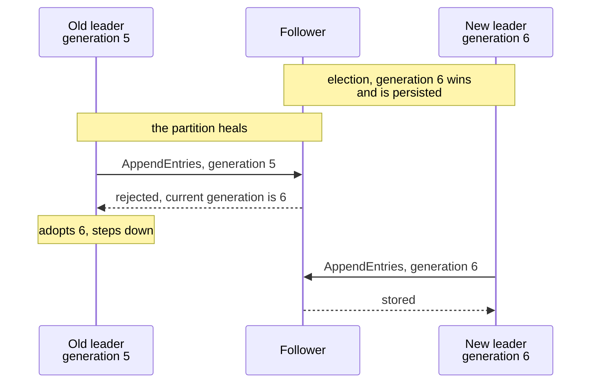
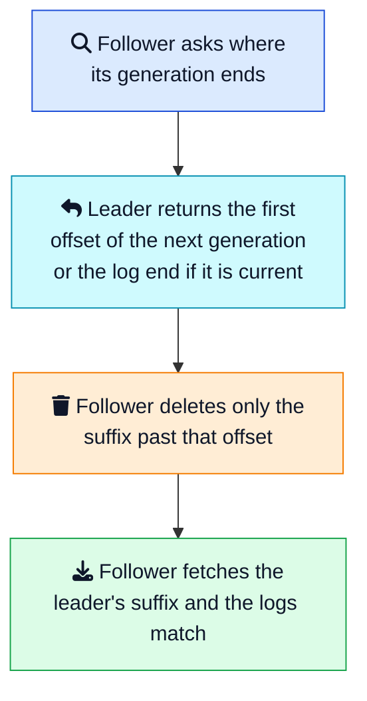

Broker B is the leader of a Kafka partition. Follower A has already fetched message m2. The bytes are on A's disk. What A does not have yet is the next fetch response, the one that would move A's high watermark past m2.

Then A restarts. The replication protocol of that era told a follower to truncate its log back to the high watermark before fetching again. m2 is deleted. A moment later B dies, and A is elected leader.

The message had been committed on B. A had a copy. After the failover, nobody has it. No checksum failed. The log is simply shorter, and it stays shorter.

That hole is [KAFKA-1211](https://issues.apache.org/jira/browse/KAFKA-1211){:target="_blank" rel="noopener"}, written up by Ben Stopford in [KIP-101](https://cwiki.apache.org/confluence/display/KAFKA/KIP-101+-+Alter+Replication+Protocol+to+use+Leader+Epoch+rather+than+High+Watermark+for+Truncation){:target="_blank" rel="noopener"}. Lengthening the election timeout leaves it open. The follower deleted a record it already stored, because the protocol said the high watermark was the safe cut. The repair is a number. It goes up every time leadership of the partition changes, it is stored beside the log, and nobody truncates until they have asked what that number means.

This number is **generation clock**. [Raft](https://raft.github.io/raft.pdf){:target="_blank" rel="noopener"} calls it a term. Kafka and ZooKeeper call it an epoch. PostgreSQL's timeline id is the same move applied to a database write ahead log. When two histories of the cluster exist, the higher number wins, and the lower number is not allowed to write.

This post walks through the rules, why the number has to hit disk before you answer, how Kafka uses it to keep m2, and where the same idea shows up in etcd, Redis, MongoDB, and a PostgreSQL failover. If you already know the [Leader and Followers](/distributed-systems/leader-follower/){:target="_blank" rel="noopener"} pattern, this is the piece that makes the leader title safe to hand to someone else.



## <i class="fas fa-bug"></i> The Hole a Timeout Cannot Close

A [leader election](/distributed-systems/leader-follower/){:target="_blank" rel="noopener"} has a liveness problem and a safety problem, and they are easy to mix up.

Liveness is "someone has to be in charge." Followers run an election timeout. Miss enough [heartbeats](/distributed-systems/heartbeat/){:target="_blank" rel="noopener"} and a new election starts. A [lease](/distributed-systems/lease/){:target="_blank" rel="noopener"} does the same job with an expiry. Both answer the question of *when* the cluster may move on.

Safety is "two someones must not both commit." A timeout cannot answer that. The old leader may be paused in a long garbage collection, stuck behind a network partition, or, in the Kafka case above, a follower may be about to throw away bytes it should have kept. From the old leader's point of view no time passed. It still holds the title. It will replicate, or produce, or acknowledge, the moment it can send packets again.

That is the zombie leader, and it is one of the standard ways a cluster reaches [split brain](/glossary/split-brain/){:target="_blank" rel="noopener"}. The generation clock is the safety half. The timeout is only the alarm.

There is a second hole, and it is the one that ate m2. Even after a single legitimate leader remains, replicas can disagree about the tail of the log. The old leader may have appended records that never reached a [majority quorum](/distributed-systems/majority-quorum/){:target="_blank" rel="noopener"}. A follower may have a suffix the new leader has never seen. If you cut that suffix with the wrong ruler, you either keep a conflicting history or you delete a committed one.

The [high watermark](/distributed-systems/high-watermark/){:target="_blank" rel="noopener"} is the wrong ruler for the cut. It marks what a replica *believes* has been committed. On a follower that belief lags the leader by a round trip. The generation, written on the records themselves, marks which leadership period produced them. That is the ruler Kafka switched to.

## <i class="fas fa-clock"></i> What a Generation Clock Is

A monotonically increasing number indicating the generation of the server. Monotonic means it only goes up. You never reuse 5 after the cluster has seen 6.

Three rules make the number useful.

1. **Bump it when leadership changes.** In Raft, a candidate increments the term when it *starts* an election, before it knows whether it will win. A split vote still consumes the term. The next attempt uses the next integer. Kafka bumps the leader epoch for each new leadership period of a partition. KIP-101 also bumps it when a broker registers after a crash that took every replica down, so a returning leader does not keep writing under the epoch it held before the outage.
2. **Store it where a crash cannot erase it.** The current generation, and the vote you cast in it, go to stable storage. Each entry in the [write ahead log](/distributed-systems/write-ahead-log/){:target="_blank" rel="noopener"} stores the generation that produced it. A reboot that comes back as generation 0 will accept instructions from a leader the rest of the cluster has already retired.
3. **Compare it on every message.** Replication, votes, heartbeats, and client writes all carry the generation. Receivers keep the highest value they have ever seen.

A generation is a period of leadership, not a single request. Term 6 might cover ten minutes and a hundred thousand log entries. Every one of those entries is stamped 6. Term 7 starts a new period, even if the same machine wins again.

Raft's paper states the safety property directly: there is **at most one leader in a given term**. "At most" is doing real work. Some terms elect nobody. A cluster that promises "exactly one leader per term" will sit forever in a split vote, inventing reasons a winner must exist. The next term is how you move on.

## <i class="fas fa-balance-scale"></i> Three Answers to Every Message

Every replica stores `H`, the highest generation it has seen. A message arrives carrying `G`. There are three outcomes, and every correct implementation handles all three. Skipping one of them is how homegrown elections corrupt data.





**G is lower.** You have already seen a newer leader. The sender is stale. Reject the append, the vote, or the produce, and tell them the generation you have. A leader that receives that rejection steps down. Silence is the bug. If you drop the message and stay quiet, the stale leader keeps trying, and if any replica is sloppy it will eventually find one that accepts.

**G matches H.** The sender is in the generation you believe is current. That is not yet a yes. The log prefix still has to match: same index, same generation on the previous entry. Two leaders cannot both be current, but a follower can still hold a tail the leader wants overwritten. The generation match gets you into the room. The prefix check decides whether the histories are the same history.

**G is higher.** Someone started an election you have not heard about, or a new leader has already won. Adopt `G` immediately, persist it, and if you thought you were leader, stop acting before you process the rest of the message. Then apply the same prefix rules. Raft writes this as: if an RPC carries a term `T` greater than `currentTerm`, set `currentTerm = T` and convert to follower.

The order matters. Adopt the higher generation *before* you append, vote, or acknowledge. A leader that appends "just this one last entry" under the old number, and only then notices, has already created the conflicting tail the new leader has to repair.

## <i class="fas fa-save"></i> The Vote Has to Hit Disk First

The generation is cheap to increment and expensive to forget.

[Raft](/glossary/raft/){:target="_blank" rel="noopener"} keeps two fields in stable storage besides the log: `currentTerm`, and `votedFor`, the candidate this server already supported in that term. The extended Raft paper is blunt about the order. Those fields are updated on stable storage **before responding to RPCs**.

Here is the bug that rule exists to kill. Term 7 begins. Node A votes for candidate B and sends the yes. The vote is still sitting in a buffer. A crashes, restarts, and the vote is gone. Candidate C asks for a vote in term 7. A votes again. B and C can both reach a majority. Two leaders, one generation, and the "at most one" property is already false. Both will append, both will tell clients the write is committed, and the [replicated log](/distributed-systems/replicated-log/){:target="_blank" rel="noopener"} now has two heads.

The fix is dull, which is why people skip it.

- Increment the generation in the same durable record as the vote for yourself.
- `fsync` that record before the vote response leaves the process.
- On startup, read the record and refuse to vote again in a generation you already voted in.
- Never let an in memory cache answer a vote the disk has not seen.

The same durability rule applies to log entries. A generation stamped on an entry that is only in memory is not a generation. After a crash the entry is gone and a different entry can occupy that index under a different generation. Kafka learned a version of this with the leader epoch checkpoint file: the log is flushed asynchronously, so after an unclean shutdown the checkpoint can run ahead of the log. On startup Kafka drops checkpoint entries whose offset is past the log end. If you keep a side file of generations, it has to be repaired against the log you actually have, or the side file will lie about where an epoch started.

One vote per generation is the other half of the same rule. A voter that says yes to two candidates in term 7, even with a perfect disk, has recreated the double leader. Retries from the *same* candidate are fine. Raft servers answer yes again if `votedFor` is already that candidate. Retries from a different candidate are a no.

## <i class="fas fa-shield-alt"></i> The Old Leader Comes Back

Put the rules in motion. Generation 5's leader is partitioned away. Followers miss heartbeats, generation 6 is elected, and clients write to the new leader. Then the network heals.



The follower does not need to know *why* generation 5 is stale. It does not inspect wall clocks, and it does not try to decide whether the old process was paused or evil. `5 < 6` is the whole test. The rejection carries 6 back to the old leader, which is how the zombie learns it is a zombie. A design that rejects and does not report the higher generation leaves the old leader retrying until a human restarts it.

This is the same shape as a [fencing token](/distributed-systems/lease/){:target="_blank" rel="noopener"} on a lease. Martin Kleppmann's [How to do distributed locking](https://martin.kleppmann.com/2016/02/08/how-to-do-distributed-locking.html){:target="_blank" rel="noopener"} shows why the storage system has to enforce the number. The lock service can expire a lease and hand the lock to someone else, and the paused holder can still write, because the pause hid the expiry from it. The generation clock is how the *cluster* notices. The fencing token is how the *data* notices. If your database, file system, or partition log does not check the number, a perfect election still loses to a late write.

Clients belong in this picture. [KIP-359](https://cwiki.apache.org/confluence/display/KAFKA/KIP-359:+Verify+leader+epoch+in+produce+requests){:target="_blank" rel="noopener"} added the leader epoch to Kafka produce requests. The broker compares it with its own epoch for that partition.

| Broker response | What it means | What the producer should do |
|---|---|---|
| `FENCED_LEADER_EPOCH` | The producer's epoch is older than the broker's | Refresh metadata and send to the current leader |
| `UNKNOWN_LEADER_EPOCH` | The producer has a newer epoch than this broker has caught up to | Back off and retry, without treating the broker as the authority |

A producer that ignores those errors will keep appending to a broker that has already lost the partition, or it will hammer a broker that is behind. The generation only fences the write if both sides look at it.

## <i class="fas fa-code-branch"></i> Where the Two Histories Split

Fencing stops the zombie from appending *new* records. It does not, by itself, repair records already sitting in a follower's log. That is the second job, and it is why m2 survived once Kafka grew a leader epoch.

Before KIP-101, a follower truncated to its local high watermark when it came up. Stopford's scenario is short enough to keep in your head. Follower A fetches m2 from leader B. A's high watermark has not moved, because that update arrives on the *next* fetch response. A restarts, truncates to the watermark, and deletes m2. B then fails. A becomes leader. m2 was committed, and it is gone.

The leader epoch gives the follower a better question than "what does my watermark say?" Each replica keeps a vector of epoch to start offset. In the log directory that vector is the `leader-epoch-checkpoint` file. The follower sends the latest epoch it has and asks where that epoch ends. The leader answers with the start offset of the next epoch, or with the log end offset if the leader is still in the requested epoch.

In the KIP's walkthrough of the m2 case, the follower's high watermark is offset 0 and the epoch response returns offset 2. Truncating to 2 deletes nothing. m2 stays. The follower then fetches anything it is actually missing. The extra round trip that made the watermark lag is no longer a data loss window.

The second scenario in the KIP is the mirror image: a power loss takes down both brokers, their flushed logs disagree, and the one that becomes leader holds a shorter history. It accepts a new message under a new epoch. The returning follower asks about its old epoch. The leader answers with the first offset of the new epoch. The follower learns that its extra suffix is an orphan, truncates that suffix only, and fetches. Both replicas now share one lineage.





Raft does the same repair inside `AppendEntries`, without a separate epoch file. The leader sends the index and term of the entry *before* the new ones. The follower checks that its entry at that index carries that term. A mismatch means the histories split at or before that index. The follower rejects, the leader backs up one index, and they repeat until the prefix matches. The leader then overwrites the follower's divergent suffix. The term on each entry is what makes "match" a real test. An index alone cannot tell two different records apart if they happen to sit in the same slot.

KIP-101 is honest about a hole it does not close. With `unclean.leader.election.enable=true` and `min.insync.replicas=1`, a series of crashes can leave a divergence that the epoch request does not see, because the epoch that would have marked the split is no longer in the lineage the follower asks about. If you turn on unclean election, you have accepted that an out of sync replica may become leader and that committed data may be dropped. The epoch makes the normal failover safe. It does not make the unsafe setting safe.

The practical split of duties is worth writing down:

| Number | Question it answers |
|---|---|
| Generation (term, epoch) | Which leadership period produced this record, and is the sender still that leader? |
| Log index or offset | Where does this record sit inside that period? |
| High watermark | Which prefix has a quorum, so readers are allowed to see it? |

Use the generation to choose a history. Use the index to find a byte. Use the high watermark to decide what a client may read. Teams get into trouble when one of these three is asked to do all three jobs.

## <i class="fas fa-random"></i> Four Clocks People Mix Up

The names collide because the implementations often share an integer. The jobs do not.

| | Generation clock | Fencing token | Lamport clock | Lease |
|---|---|---|---|---|
| What moves it | A new election or a new leadership period | Each grant of a lock or lease | Every send, receive, and local event | A deadline on a clock |
| Who checks it | Peers, on votes and replication | The resource being protected | Whoever receives the message | The lease service, then the resource if you also fence |
| What it saves you from | A stale leader and a divergent log tail | A paused lock holder writing after expiry | Unordered events with no shared wall clock | A crashed holder keeping a lock forever |
| Where it lives | Stable storage and every log entry | The highest token the resource has accepted | Inside the message | A record with a TTL |

A [Lamport clock](/distributed-systems/lamport-clock/){:target="_blank" rel="noopener"} ticks on every event, and on receive it jumps to one past the max of the local and incoming values. A generation clock ticks when leadership changes, and on receive it jumps to the max, with no extra plus one for an ordinary message. Ongaro and Ousterhout describe Raft terms as a logical clock for exactly this reason: servers use them to detect stale leaders. The Lamport post shows the family resemblance. The difference you implement is the tick rate, and the fact that a generation is also a vote boundary.

A fencing token is often *issued from* the generation. Kafka's leader epoch, a ZooKeeper zxid, a Raft term presented by a client: any of those can be the token storage checks. You can also have a fencing token with no cluster election at all. A single lock service hands out 41, then 42, then 43, and the database rejects 41 after it has seen 42. That is Kleppmann's picture, and it is enough for a lock. It does not, by itself, tell a follower which log suffix to delete. If you are replicating a log, you want the generation on the entries. If you are guarding one row, a fencing token on the write is the piece that matters. Many systems need both, because the election and the data store are different processes.

A lease without either number is an efficiency hint. It will usually fail over, and it will occasionally let two holders act. The lease post's comparison table is the short version: the combination of a deadline and a token is what makes the lock safe under a process pause.

## <i class="fas fa-server"></i> The Same Idea, Six Production Names

You do not have to invent this for a new service. You do have to recognize it, because the name changes every time you cross a project boundary.

### Raft, and the Kubernetes control plane

etcd, Consul, CockroachDB, and TiKV run Raft. The generation is the term. etcd is the datastore under the Kubernetes control plane, so a leader change in that store is fenced by a Raft term. High availability for the control plane still needs more than one etcd node and a majority. The term is what keeps those nodes from accepting a write from the leader they just replaced.

Kubernetes controller manager and the scheduler then run a *second* mechanism on top: a [lease](/distributed-systems/lease/){:target="_blank" rel="noopener"} in etcd so only one replica of the controller acts. The term fences etcd's own leader. The lease fences the controller. [Consistent core](/distributed-systems/consistent-core/){:target="_blank" rel="noopener"} is the name for "put the small, precious metadata in the Raft cluster, and let everyone else trust it."

If you embed Raft, do not reimplement the term. The libraries already persist `currentTerm` and `votedFor`, reject stale terms, and step down on a higher one. The bugs that remain are usually outside the library: a downstream write that forgets to carry the term, or a client that treats "I was leader a moment ago" as still true.

### Kafka's leader epoch

Every partition has its own epoch. The active controller (ZooKeeper in older clusters, KRaft in current ones) assigns it, and the leader stamps record batches with it. Followers truncate through `OffsetsForLeaderEpoch` rather than to the high watermark. Producers and fetchers send the epoch they last heard and handle `FENCED_LEADER_EPOCH`.

The epoch is 32 bits. That is a lot of failovers. The failure mode that matters is a bug that *resets* the counter, or a broker that accepts a produce with no epoch check because the client is old. Treat the number as monotonic for the life of the partition. Our [how Kafka works](/distributed-systems/how-kafka-works/){:target="_blank" rel="noopener"} walkthrough follows the write path these epochs sit on.

### ZooKeeper's epoch, packed into the zxid

ZooKeeper's transaction id is a 64 bit zxid. The [internals doc](https://zookeeper.apache.org/doc/current/zookeeperInternals.html){:target="_blank" rel="noopener"} splits it in half: the high 32 bits are the epoch, the low 32 bits are a counter. A new leader gets its own epoch, and leadership activation is what guarantees only one leader uses that epoch. The leader then increments the zxid for each proposal. Clients and followers that compare zxids are comparing epoch first and counter second, so everything from epoch 9 sorts before everything from epoch 10, even when the counter goes back to zero.

That packing is a useful trick when you want one totally ordered id and also want the generation to be visible inside it. The risk is the 32 bit counter. A leader that proposes more than four billion changes in one epoch will overflow the low half. ZooKeeper's design assumes an epoch ends long before that. If you copy the layout, put an alarm on the counter, and do not let overflow wrap a new zxid into a value that looks older.

### Redis Cluster's config epoch

The [Redis Cluster spec](https://redis.io/docs/latest/operate/oss_and_stack/reference/cluster-spec/){:target="_blank" rel="noopener"} says the design is the Raft term under another name. `currentEpoch` is a 64 bit cluster logical clock. Seeing a higher epoch on any packet moves the local clock forward. `configEpoch` is the generation of a master's slot ownership. A replica that wants to replace a failed master increments the epoch, wins a majority of master votes, and only then promotes itself.

Two details are worth stealing.

The new `configEpoch` is unique and higher than previous ones, and every node that learns about a change `fsync`s `currentEpoch` and `configEpoch` to `nodes.conf` **before it continues**. That is the same "disk before the next step" rule as Raft's vote. And when two nodes claim the same hash slots, the higher config epoch wins. The number is the conflict resolution, not a hint.

[Redis Sentinel](https://redis.io/docs/latest/operate/oss_and_stack/management/sentinel/){:target="_blank" rel="noopener"} uses a configuration epoch the same way for a single primary. A sentinel must be authorized by a majority, that authorization carries a unique epoch, and during propagation the greater version wins. A failover without that version is how two sentinels promote two replicas.

### PostgreSQL timeline ids

PostgreSQL does not run Raft. It still grew a generation clock, because point in time recovery and standby promotion create branches in the write ahead log.

The [timelines section](https://www.postgresql.org/docs/current/continuous-archiving.html#BACKUP-TIMELINES){:target="_blank" rel="noopener"} of the docs is plain about why. If you recover to Tuesday 5:14pm and then keep writing, those new WAL records must not overwrite the original Wednesday history you might still want. Whenever archive recovery completes, PostgreSQL creates a new timeline. Promoting a standby is that completion. The timeline id is the first eight hex digits of a WAL file name: in `0000000100001234000055CD`, `00000001` is timeline 1. A small `.history` file records which timeline this one branched from and where.

For disaster recovery this is the difference between "we promoted the standby" and "we promoted the standby and the old primary's later WAL silently continued the same file names." Archive commands are told to refuse to overwrite an existing file. The timeline id is what makes that refusal correct rather than a collision. Tools such as `pg_rewind` exist because the old primary, once it sees the new timeline, has to throw away the suffix that diverged. Same repair as the Kafka follower, different file format.

### MongoDB replica set terms

Since protocol version 1, which has been the default since MongoDB 3.2, replica set elections use a term. The [protocol version page](https://www.mongodb.com/docs/manual/reference/replica-set-protocol-versions/){:target="_blank" rel="noopener"} credits the term with two concrete results: faster detection of two members that both think they are primary, and prevention of double voting inside one member's call for an election.

The same page is careful, and you should be too. Two members can still *briefly* both believe they are primary, usually because a partition has not yet delivered the higher term to the old one. At most one of them can complete writes with `w: "majority"`. Writes that landed only on the former primary roll back. The term is the fence. Majority write concern is how a client actually stands behind the fence. A driver pointed at the old primary with `w: 1` can still observe a write that later disappears.

## <i class="fas fa-code"></i> The Rules in One Node

This is a sketch of one node, not a Raft library. It persists the generation and the vote before a yes, it grants one vote per generation, and it refuses an append whose previous entry is from a different generation. A real node also tracks the commit index, which is the [high watermark](/distributed-systems/high-watermark/){:target="_blank" rel="noopener"}, and it has to survive the disk returning an error. The control flow is the part to copy.

```python
class Store:
    def __init__(self):
        self.generation = 0
        self.voted_for = None
        self.log = []  # {"gen": int, "cmd": str}

    def save(self):
        # Durably write generation, voted_for, and log.
        # Callers must do this before they send a vote or an ack.
        pass


class Node:
    def __init__(self, node_id, store):
        self.id = node_id
        self.store = store
        self.role = "follower"

    def _last(self):
        if not self.store.log:
            return (0, -1)
        last = len(self.store.log) - 1
        return (self.store.log[last]["gen"], last)

    def observe(self, incoming):
        if incoming > self.store.generation:
            self.store.generation = incoming
            self.store.voted_for = None
            self.role = "follower"
            self.store.save()

    def request_vote(self, gen, candidate, last_index, last_gen):
        self.observe(gen)
        if gen < self.store.generation:
            return False
        if self.store.voted_for not in (None, candidate):
            return False
        if (last_gen, last_index) < self._last():
            return False  # candidate's log is behind
        self.store.generation = gen
        self.store.voted_for = candidate
        self.store.save()  # fsync before this yes leaves the process
        return True

    def append(self, gen, prev_index, prev_gen, cmd):
        self.observe(gen)
        if gen < self.store.generation:
            return False
        if prev_index == -1:
            self.store.log.clear()
        else:
            if prev_index >= len(self.store.log):
                return False
            if self.store.log[prev_index]["gen"] != prev_gen:
                return False  # histories split here
            del self.store.log[prev_index + 1:]
        self.store.log.append({"gen": gen, "cmd": cmd})
        self.store.save()
        return True
```

Read `request_vote` from the crash's point of view. `observe` runs first, so a higher generation replaces whatever this node believed. The `voted_for` check is what stops the second yes in the same generation, while still allowing the original candidate to retry. The tuple compare `(last_gen, last_index)` is Raft's up to date test: a higher last generation wins, and an equal generation goes to the longer log. A candidate that is missing committed entries must not win, or the commit will be gone with the old leader.

`append` is the truncation rule in miniature. A mismatched `prev_gen` is a no. The leader will try an earlier index. A match means everything after `prev_index` is uncommitted tail and can be replaced. The new entry is stamped with the leader's generation, not with whatever generation the follower used to be in.

What the sketch leaves out on purpose: heartbeats, the commit index, and snapshot transfer. Those are the heartbeat, high watermark, and log compaction patterns. Bolting them on without the generation checks above is how a weekend project grows a split brain.

## <i class="fas fa-exclamation-triangle"></i> Ways This Still Loses Data

**The generation lives in a variable.** Restart, and you are back at zero. Every peer that still has your old messages will look "from the future," or worse, you will accept a stale peer because you no longer remember 6. Persist the counter in the same place you persist the log.

**The vote is persisted after the reply.** The double vote in one generation, described above. The window is short and the outage is the kind that shows up once a year under a power blip. `fsync` before the response. Measure the latency and pay it. An election is rare compared with ordinary writes.

**You check the generation on the election and nowhere else.** The zombie does not only send vote requests. It sends appends, produces, and "I am still leader" responses to clients. Every path that mutates state carries the number. KIP-359 exists because the broker side replication check was not, by itself, on the produce path.

**You step down late.** Seeing a higher generation and finishing the current disk write "because it is almost done" is how conflicting suffixes are born. The first action is to stop accepting new work and to persist the higher generation. Then you can look at the message.

**You truncate to the high watermark.** That is the m2 bug. Cut on the generation boundary the leader reports. Advance the watermark only so readers know what is committed.

**You use a wall clock as the generation.** A counter you increment and store does not care that NTP stepped backward. A generation that is a timestamp does. [Cassandra gossip](https://cassandra.apache.org/doc/latest/cassandra/architecture/dynamo.html){:target="_blank" rel="noopener"} carries a generation so peers can tell a restarted node from the previous life of that process, and that value has long been the node's startup time. A backward clock step can make the new life look older than the state it should replace. If you are marking "this process started again," store an integer on disk and add one. Leave the wall clock out of the comparison.

**You let the counter wrap or reset.** A 32 bit Kafka leader epoch or a 32 bit ZooKeeper epoch will not wrap in a healthy cluster. A bug that sets the counter to zero on a rolling deploy will. After a reset, old messages look newer. Pin the value in stable storage, and alert if it ever decreases. Decreasing is a bug, not a failover.

**Unclean leader election, or `w: 1`.** The generation cannot invent a copy of the data that was never replicated. Kafka's unclean election and MongoDB's non majority writes are availability choices. They have a documented window where a writer acknowledges something the new leader does not have, or where two primaries overlap until the term arrives. If the product cannot lose that write, keep the minimum in sync replicas above one, and wait for a majority.

**A homegrown election when etcd or ZooKeeper is already on the platform.** The [Chubby paper](https://research.google/pubs/the-chubby-lock-service-for-loosely-coupled-distributed-systems/){:target="_blank" rel="noopener"} spends a surprising amount of time on bugs in services that rolled their own locks. If the generation clock you need is "only one controller should act," take a lease and a fencing token from a [consistent core](/distributed-systems/consistent-core/){:target="_blank" rel="noopener"} you did not write. Build your own only when you are the log, the way Kafka and etcd are.

## <i class="fas fa-check-circle"></i> When the Number Is Worth Keeping

Keep a generation clock when a stale holder can still reach the data after the cluster has moved on, or when replicas can disagree about the tail of a log.

That includes a primary and its standbys, a partition leader and its followers, a Raft group, a lock service that issues fencing tokens from a counter, and a write ahead log that branches during failover or point in time recovery. If you are adding replication to a service and the failover design is "the other node will notice and take over," the design is missing this number.

You can skip it when two writers are an acceptable, reconcilable outcome. Leaderless databases do that on purpose and use other clocks to merge conflicts. A cache that can be wrong for a minute can skip it. A background job that is idempotent and cheap to run twice can skip it, and should still think hard about what "twice" does to a customer.

If you keep it, the checklist is short.

1. Increment on each election attempt or each new leadership period, and never reuse a value.
2. Persist the generation and the vote before you answer.
3. Grant one vote per generation.
4. Stamp every log entry and every mutating RPC, including client writes.
5. Reject a lower generation, adopt a higher one, and step down before doing anything else.
6. Repair a divergent suffix by the generation boundary, and let the high watermark decide only what readers can see.

## <i class="fas fa-flag-checkered"></i> Wrapping Up

Go back to follower A and message m2. A had the bytes. The high watermark had not caught up. The protocol deleted the message, A became leader, and a committed write disappeared without an error at the moment it mattered.

The generation clock is the number that would have been sitting on those bytes. Asked where epoch N ends, the leader would have said "offset 2, keep it." Asked to accept a replication request from the deposed leader a moment later, the follower would have said "I have already seen a higher generation." Same integer, two jobs: pick one history, and refuse the person who is still holding the old title.

Timeouts and leases decide when the cluster is allowed to move on. Majorities decide whether a write is durable. The generation decides which leader is real, and which suffix of the log is fiction. Leave it out, and a failover is a coin flip you only notice on the next restore.

---



**Related posts:**

- [Leader and Followers](/distributed-systems/leader-follower/){:target="_blank" rel="noopener"} - The replication pattern a generation clock protects during failover
- [Lease Pattern](/distributed-systems/lease/){:target="_blank" rel="noopener"} - Time bound ownership, and the fencing token the generation often becomes
- [High Watermark](/distributed-systems/high-watermark/){:target="_blank" rel="noopener"} - The commit index you should not use as the truncation point
- [Replicated Log](/distributed-systems/replicated-log/){:target="_blank" rel="noopener"} - Where each entry stores the generation that produced it
- [Lamport Clock](/distributed-systems/lamport-clock/){:target="_blank" rel="noopener"} - The logical clock a term or epoch is a coarse version of
- [Write Ahead Log](/distributed-systems/write-ahead-log/){:target="_blank" rel="noopener"} - The durable log a generation has to survive inside
- [Consistent Core](/distributed-systems/consistent-core/){:target="_blank" rel="noopener"} - etcd and its relatives, where a Raft term fences cluster metadata
- [How Kafka Works](/distributed-systems/how-kafka-works/){:target="_blank" rel="noopener"} - Leader epochs on the partition write path

*Further reading: [Generation Clock](https://martinfowler.com/articles/patterns-of-distributed-systems/generation-clock.html){:target="_blank" rel="noopener"} chapter in Patterns of Distributed Systems; the [Raft paper](https://raft.github.io/raft.pdf){:target="_blank" rel="noopener"} by Diego Ongaro and John Ousterhout; Kafka [KIP-101](https://cwiki.apache.org/confluence/display/KAFKA/KIP-101+-+Alter+Replication+Protocol+to+use+Leader+Epoch+rather+than+High+Watermark+for+Truncation){:target="_blank" rel="noopener"} and [KIP-359](https://cwiki.apache.org/confluence/display/KAFKA/KIP-359:+Verify+leader+epoch+in+produce+requests){:target="_blank" rel="noopener"}; the [ZooKeeper internals](https://zookeeper.apache.org/doc/current/zookeeperInternals.html){:target="_blank" rel="noopener"} note on zxids; the [Redis Cluster spec](https://redis.io/docs/latest/operate/oss_and_stack/reference/cluster-spec/){:target="_blank" rel="noopener"}; PostgreSQL's [timelines](https://www.postgresql.org/docs/current/continuous-archiving.html#BACKUP-TIMELINES){:target="_blank" rel="noopener"} section; and Martin Kleppmann's [How to do distributed locking](https://martin.kleppmann.com/2016/02/08/how-to-do-distributed-locking.html){:target="_blank" rel="noopener"}.*
