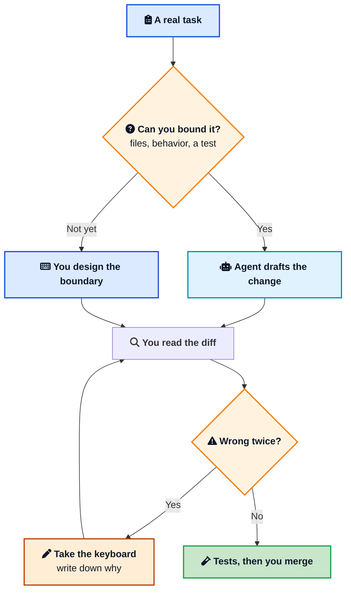

In late October 2026, Amazon published a new role guideline for software development engineers and put it where customers could read it. [Terk Terkowitz](https://www.aboutamazon.com/news/company-news/amazon-software-engineer-role-guideline-ai){:target="_blank" rel="noopener"}, VP and Distinguished Engineer for Worldwide Amazon Stores, wrote it after Distinguished and Senior Principal Engineers compared the people who were actually shipping.

The line they were willing to say in public is the one a lot of internal dashboards dodge:

> Our most prolific engineers have demonstrated that neither the developer role nor their output is defined by the use of AI.

They still want you in the tools. The same memo says that whatever best practice looks like next, AI will sit at the center of it, and that waiting is how you fall behind. What they refused to do is freeze a definition of "good AI use" into the job ladder. They think any definition written this year will look dated next year. So they wrote the part they believe will still be true: impact on customers, the business, and the team.

That is a narrower claim than the headlines, and it is the useful one. Shopify, Google, Microsoft, and Meta have been rewriting the same job since 2025, each with a different scoreboard. This post lines those documents up, then turns them into a week of work you can actually run. If you want the editor habits first, [Getting the Most Out of AI Coding Assistants](/ai-coding-assistants-guide/){:target="_blank" rel="noopener"} is the companion. This one is about the job around the editor.



## <i class="fas fa-clipboard-list"></i> What Amazon Wrote Down

The guideline starts from a fight the senior engineers had with themselves. For twenty years Amazon tried to keep the SDE role description free of specific technologies. Cloud, microservices, and serverless all changed the work, and the role text stayed about outcomes. AI felt different to them. Faster, and closer to the question of what the job even is. They still wrote the durable text around the part they expect to last.

Terkowitz borrows a Jeff Bezos line from a 2012 interview with Werner Vogels. The question Bezos wanted was the one people skip: what will still be true in five or ten years. At Amazon, the answer they wrote down is customer impact, business impact, and team impact.

The uncomfortable half of the memo is about measurement. They know leaders are reaching for numbers they can see this quarter:

- tokens consumed
- seats and logins for AI tools
- code changes and reviews

They also know those numbers come loose from the work. Used as a target, token spend fights frugality. They even gave it a name, tokenmaxxing. Used as a target, lines of code fight "invent and simplify." A bigger diff is easy to produce and expensive to live with.

They keep the numbers, with a narrow use. In their view the same inputs still correlate with delivery, for now, for two reasons. Teams they call frontier teams, the ones that have folded the tools into real work, are pulling ahead. Teams and individuals who are not adopting the tools are falling behind. The recommendation is to watch the tails with judgement. The 10th percentile is where adoption is thin: find out why. The 90th percentile is where usage is heavy: find out whether delivery moved with it. A team can sit in the 90th percentile of tokens and the 10th percentile of customer outcomes. Copy a team when the delivery moved with the usage.

There is a sentence in the memo worth pinning above a dashboard. If your work does not benefit from current AI tooling, that is a finding, not a failing. Write down why, share it with peers, take it to your manager, and look for a way through. An engineer who can explain where the tool still loses is demonstrating the judgement they asked for. An engineer who cannot name a single failure is probably not looking.

Leaders get a concrete bar. Sufficient understanding means you have used the tools on your own production work, you can describe a task where they helped and a task where they did not, and you can explain that judgement to the team. A slide about someone else's pilot does not clear that bar.

The last shift is easy to skip because it sounds like an old leadership poster. Terkowitz says the engineers getting the most from [agentic coding](/glossary/agentic-coding/){:target="_blank" rel="noopener"} are the ones closest to the product and the customer. As Amazon grew, some individual contributors and managers drifted away from both. The guideline tells them to walk back. Scope grows with seniority. The tool does not replace that walk. It punishes you for skipping it, because a fast agent aimed at the wrong problem writes the wrong system quickly.

### Where the phrase came from

In December 2025, at AWS re:Invent, Werner Vogels used the same label in his keynote: the renaissance developer. The [AWS write-up](https://aws.amazon.com/blogs/aws/aws-weekly-roundup-aws-reinvent-keynote-recap-on-demand-videos-and-more-december-8-2025/){:target="_blank" rel="noopener"} quotes the version that matters. Some tasks will be automated and some skills will age out. His answer to "will AI make me obsolete?" was that you stay relevant if you evolve. Then the line the role guideline is trying to operationalize: "The work is yours, not that of the tools. You build it, you own it."

Vogels described the person as curious, a systems thinker, a clear communicator. Amazon's 2026 text takes that stage line and aims it at promotions, metrics, and what a manager is supposed to know firsthand. The label is theirs. The practice underneath it is available to anyone.

## <i class="fas fa-building"></i> How Other Companies Drew the Line

Amazon showed up late and careful. Other companies had already told their engineers what "using AI" meant in a review conversation. Read each one as its own document. The temperatures differ.

### Shopify made it a baseline

On April 7, 2025, Shopify CEO Tobi Lütke posted an internal memo himself after it started to leak. [The Verge's account](https://www.theverge.com/news/644943/shopify-ceo-memo-ai-hires-job){:target="_blank" rel="noopener"} matches what he published. Reflexive AI use was now a baseline expectation. Everyone, including the executive team. Using it well was a skill you learn by using it a lot, because a single prompt that misses is where most people quit. AI usage questions would go onto the performance and peer review questionnaire. Before a team asked for more headcount or resources, it had to show why AI could not get the work done, including the question of what the area would look like if agents were already on the team.

Shopify later described what that year looked like from the inside. In [a company post](https://www.shopify.com/news/unserious-exploration){:target="_blank" rel="noopener"} they said the memo was followed by universal adoption of AI code editors, thousands of Cursor licenses, and unlimited access to top models for every team. Treat that as their account of their own building, not an independent audit.

The sharpest picture of the new interview is from Farhan Thawar, Shopify's head of engineering, in conversation with [Gergely Orosz](https://newsletter.pragmaticengineer.com/p/how-ai-is-changing-software-engineering){:target="_blank" rel="noopener"}. He described adding a coding interview for directors and above, because Shopify wants them close to the work. Candidates may use the tools. Thawar's tell is what happens when the model emits a bad patch. Some people keep prompting an obvious fix. He wants the candidate who can see the bad line and change it. The copilot is assumed. Taste is the test.

### Google told engineers to use it, and kept the old bar

In April 2025, Sundar Pichai said on Alphabet's earnings call that more than 30% of new code at Google was written by AI, up from 25% the previous October. Humans still reviewed it before it was accepted. [Business Insider reported the figure](https://www.businessinsider.com/ai-code-meta-microsoft-google-llamacon-engineers-2025-4){:target="_blank" rel="noopener"} from that call. The percentage counts code the model drafted. People still reviewed it before it landed.

On June 30, 2025, Google emailed software engineers a set of recommendations written by other engineers. [9to5Google reported](https://9to5google.com/2025/06/30/google-engineers-ai-code/){:target="_blank" rel="noopener"} the public parts, including Google's own statement: the guidance was there to help every SWE get more out of AI in daily work. The same reporting says the document stresses rigor in code review, security, and maintenance. [Business Insider added](https://www.businessinsider.com/google-employees-use-ai-or-get-left-behind-gemini-2025-8){:target="_blank" rel="noopener"}, from people who saw the guidelines, that coding was supposed to stay on internal models, that third party tools needed approval, and that AI-written code was still the employee's work and had to meet Google's standards. Some role profiles were updated to mention using AI to solve problems.

A Google spokesperson told Business Insider the company encourages daily use and is not scoring people on it in performance reviews. Employees told the same reporter that some managers were already asking for a demonstration of daily use, and that people expected it to matter anyway. Hold both facts. The written standard that is safe to copy is the one Google has said in public: use the tools, and the diff is still yours.

### Microsoft and Meta described the new seat

At Meta's LlamaCon in April 2025, Satya Nadella said AI was writing 20% to 30% of the code in some Microsoft projects, and that the share depended on the language. He also said internal agents that review code were seeing more use. Mark Zuckerberg did not have a current percentage for Meta. He offered a bet instead: within about a year, maybe half of software development would be done by AI, and engineers would look more like tech leads with a small army of agents. [InfoWorld's account of that conversation](https://www.infoworld.com/article/3975472/open-source-has-a-massive-role-to-play-in-ai-orchestration-platforms-says-microsoft-ceo.html){:target="_blank" rel="noopener"} is the source. Keep that as a bet from April 2025. The part that aged into everyday tools is the shape of the seat: you direct, you review, you work inside a repo that already exists.

Nadella's other point on that stage is the one greenfield demos skip. Most engineers work in a repository that already has callers, history, and a deploy pipeline. The productivity shows up when the agent fits the toolchain and the existing codebase. A weekend prototype that impresses a group chat is a different sport from a change in a service with ten years of callers.

Microsoft's own engineering blog later showed what "direct the agent" looks like on a real migration. In [Treating AI agents as collaborators](https://devblogs.microsoft.com/engineering-at-microsoft/the-interaction-changes-everything-treating-ai-agents-as-collaborators-not-automation/){:target="_blank" rel="noopener"}, a team moving repos onto a newer authentication SDK stopped handing the agent a bare step list. They gave it a role on the migration, a mission, and hard boundaries: do not weaken auth or validation, do not edit outside the task, stop and ask when unsure, and do not guess. They reported that accuracy and edge case handling improved, and that the agent started escalating uncertainty instead of inventing a fix. You can steal the shape of that prompt without copying their migration. A role, a fence, and a way to say "I don't know" beat a wish.

### Four scoreboards

| | What they ask of you | What they warn against | How it shows up in reviews |
|---|---|---|---|
| Amazon (Oct 2026) | Learn the tools on production work. Stay close to the customer. Explain a win and a miss. | Targeting tokens, lines of code, or raw review counts. | Outcomes. Usage is a signal. Watch the 10th and 90th percentile. |
| Shopify (Apr 2025) | Reach for AI as a reflex, including prototypes. Show why AI cannot do it before you ask for headcount. | Treating the tools as optional. | AI questions on performance and peer review. |
| Google (Jun 2025) | Use AI. Keep review, security, and maintenance standards. Generated code is your code. | Shipping a diff you cannot stand behind. Reported separately: pasting internal code into outside tools. | Encouraged. A spokesperson said it is not itself a performance score. |
| Microsoft and Meta (public remarks, 2025) | Direct agents inside real repos. Review their output. | Assuming a blank-repo demo transfers to a large codebase. | No single public role guideline. The expected seat is "tech lead of agents." |

The disagreement that matters is the review form. Shopify is willing to ask peers how you use AI. Amazon is willing to say that a usage target will rot the culture. Google's official line, as of the August 2025 reporting, is encouragement without a score. If your company is writing its own version this quarter, that is the decision to argue in the room. Use is the floor. The score is the outcome.

## <i class="fas fa-chart-bar"></i> What the Numbers Under the Memos Actually Say

Company memos describe intent. Surveys and experiments describe what happened when developers sat down. The memos are cleaner than the studies. Read the studies anyway.

### DORA: AI Amplifies the System You Already Have

The [2025 DORA report](https://dora.dev/research/2025/dora-report/){:target="_blank" rel="noopener"}, State of AI-assisted Software Development, draws on nearly 5,000 technology professionals. [Google's summary](https://blog.google/innovation-and-ai/technology/developers-tools/dora-report-2025/){:target="_blank" rel="noopener"} is the readable version of the headlines:

- About 90% reported using AI at work, up 14 points from the year before. The median time spent with it was about two hours a day.
- More than 80% said it increased their productivity.
- 59% said it had a positive effect on code quality.
- About 30% had little or no trust in the code AI generated. Trust and use are living in the same people.
- Adoption lined up with higher software delivery throughput and better product performance. It still lined up with worse delivery stability.

The stability finding is the one to take to a staff meeting. AI lets a team produce more change. If the path from commit to production is a slow CI/CD pipeline, a brittle test suite, or a review culture that skims, the extra change shows up as incidents. DORA's own theory is that AI amplifies the system you already have. Strong internal platforms, clear workflow, fast feedback, and a user in mind make the tools pay off. A tangled codebase and a monthly deploy make them a faster way to create repair work.

User focus shows up in the same data as a measured condition. Pointed at a clear user problem, the tools help team performance. Pointed at "be more productive," they help you generate diffs. Amazon's insistence on customer proximity is the same finding in a role guideline.

### Stack Overflow: use is up, trust is down

The [2025 Stack Overflow Developer Survey](https://survey.stackoverflow.co/2025/ai){:target="_blank" rel="noopener"} heard from more than 49,000 developers. On AI, the split is blunt:

- 84% were using or planning to use AI tools, up from 76% in 2024. 51% of professional developers used them daily.
- 46% distrusted the accuracy of the output. 33% trusted it. 3% highly trusted it. Experienced developers were the most skeptical.
- Positive sentiment fell to about 60%, from above 70% in the two prior years.
- The frustration Stack Overflow highlights in its [leader notes](https://stackoverflow.co/internal/resources/2025-stack-overflow-developer-survey-for-leaders/productivity-paradox/){:target="_blank" rel="noopener"} is the almost right answer: 66% named outputs that are "almost right, but not quite," and 45% said debugging AI-written code takes longer than writing it themselves.
- In the [press release](https://stackoverflow.co/company/press/archive/stack-overflow-2025-developer-survey/){:target="_blank" rel="noopener"}, 31% were using AI agents, 17% planned to, and 38% did not plan to. Among people who had used agents at work, 69% agreed they were more productive.
- 64% did not see AI as a threat to their job. That was 68% the year before.
- When they do not trust an answer, 75% would still ask a person. The survey's own reading is that human developers remain the people who decide correctness.

Daily use plus weak trust is a stable pattern. Developers already know the tool will hand them something that compiles and misses the case that pages them. The role is growing around that knowledge. If your process has no time budget for the "almost right" tax, the survey says you will pay it anyway, in debugging, after the merge.

Cursor, Claude Code, and Windsurf showed up as IDEs in that same survey at 18%, 10%, and 5%. VS Code was still the default. The job is not "switch editors." The job is review, in whatever editor your repo already lives in. [GitHub Copilot](https://docs.github.com/en/copilot){:target="_blank" rel="noopener"} inside VS Code and an agent in Cursor fail in the same way when the task was vague.

### METR: the feeling of speed is a bad instrument

In July 2025, [METR published a randomized trial](https://metr.org/blog/2025-07-10-early-2025-ai-experienced-os-dev-study/){:target="_blank" rel="noopener"} of 16 experienced open source developers doing 246 real tasks in repositories they already knew. With early 2025 tools, mostly Cursor Pro and Claude 3.5 or 3.7 Sonnet, the tasks took 19% longer. Before the study, the same developers expected to be 24% faster. Afterward, having been slowed down, they still believed they had been 20% faster.

METR has since marked that result as historical. In [a February 2026 update](https://metr.org/blog/2026-02-24-uplift-update/){:target="_blank" rel="noopener"} they said later tools probably speed people up, and that their follow-up experiment could not measure the effect cleanly. Developers were opting out of tasks they did not want to do without AI. People who expected the largest speedup were the least willing to work with the tools turned off. Concurrent agents also broke a measurement that assumes one task and one clock. Raw estimates in that follow-up were an 18% speedup for returning participants and 4% for newly recruited ones, with wide intervals, and METR treats both as weak lower bounds.

Two lessons survive the correction.

The first is that self-report is a poor speedometer. The early study's developers were wrong about the sign. If your retro is "it felt faster," you do not yet have evidence.

The second is that the tasks people refuse to do by hand are exactly the ones a "turn the AI off" study loses. Aggregate productivity and the productivity of one familiar two hour bug are different questions. Amazon's advice to keep anecdotes next to the averages is a practical answer to that gap. Track a few tasks all the way to production. See whether the incident rate, the review time, and the customer bug moved. A feeling in the editor is not that number.

Addy Osmani has a [widely shared way of talking about the leftover work](https://addyo.substack.com/p/beyond-the-70-maximizing-the-human){:target="_blank" rel="noopener"}: tools get a rough version standing quickly, and the last stretch, requirements, edges, architecture, and correctness, is where engineering still lives. He frames it as roughly 70% and 30%. Treat the split as a metaphor from a practitioner. The useful part is the list of leftovers. They are the job description the memos are circling.

## <i class="fas fa-project-diagram"></i> The Job, Drawn as a Loop

Put the memos and the research in one picture and the seat looks like this. A person opens the loop. A person closes it. The agent sits in the middle.

```mermaid
flowchart LR
    Customer["fa:fa-user <b>Customer problem</b>"] --> Bounds["fa:fa-lock <b>You set the bounds</b><br/>files, behavior, tests"]
    Bounds --> Agent["fa:fa-robot <b>Agent edits</b>"]
    Agent --> Review["fa:fa-search <b>You read the diff</b>"]
    Review --> Checks["fa:fa-vial <b>Tests and CI</b>"]
    Checks --> Own["fa:fa-flag <b>Outcome you own</b>"]

    classDef human fill:#dbeafe,stroke:#1d4ed8,stroke-width:2px,color:#0f172a
    classDef agent fill:#e0f2fe,stroke:#0891b2,stroke-width:2px,color:#0f172a
    classDef check fill:#fff3e0,stroke:#f57c00,stroke-width:2px,color:#0f172a
    classDef own fill:#c8e6c9,stroke:#16a34a,stroke-width:2px,color:#0f172a

    class Customer,Bounds,Review human
    class Agent agent
    class Checks check
    class Own own
```





Walk a normal change through it.

A support ticket says checkout fails when a saved card has no postal code. You decide this is a real bug, you name the payment client and its test, and you tell the agent not to touch auth, logging format, or public method signatures. The agent drafts a retry, or a null check, or both, because you were not tight enough. You read the diff. You delete the retry, because the bug was a missing field, and a retry would have charged twice. CI runs the test you wrote for the empty postal code. You merge. If Friday's dashboard shows a drop in those failures, the outcome belongs to you. If it shows a spike in double charges, that belongs to you too.

The loop is the old job with a faster, overconfident pair programmer. The 2026 failure mode is skipping the bounds and the review. People paste the ticket in, accept the diff, and call the token count a day's work. Andrej Karpathy popularized a name for the casual version of that skip in early 2025: vibe coding, where you stop reading and let the output stand. It is a fine way to learn a library on a Saturday. It is a bad way to own checkout.

## <i class="fas fa-user-check"></i> The Work That Still Sits With You

The tools are genuinely good at a long list of chores: boilerplate, a first test, a migration with a mechanical pattern, explaining a file you have not opened in a year, a regex you did not want to write. Denying that is how people get surprised in interviews like Shopify's. The work that keeps an SDE in the loop is everything the chore list assumes someone else already did.

**Name the problem in the customer's words.** An agent will implement the ticket you typed. If the ticket is the wrong diagnosis, you get a clean implementation of a misunderstanding. Amazon's guideline is pushy about this because they watched senior people drift into internal abstractions. Spend time where the failure is felt. Read the ticket, the refund, the merchant complaint. Then decide whether the fix is code.

**Draw the boundary before the edit.** Which service owns this rule? What breaks for the caller if the response shape changes? What is the rollback? Agents are local. They see the files you attached and the repo search they thought to run. The design review, where another team promised that field would stay optional, is still a human conversation. If you want a refresher on how an agent loop is built, [How to Build AI Agents](/building-ai-agents/){:target="_blank" rel="noopener"} is the mechanics. The boundary around the loop is the engineering.

**Review like the author.** The diff can be confident and wrong in a quiet way: a check that passes because the test mocks the bug, a query that works on ten rows, a security check removed because it was "in the way" of the happy path. The [review checklist for AI written code](/ai-coding-assistants-guide/){:target="_blank" rel="noopener"} still holds. Logic, security, performance, errors, and whether another human can read it in six months. A second model can draft review comments. [A code review assistant](/building-code-review-assistant-with-llms/){:target="_blank" rel="noopener"} is a useful first pass. The merge button is still a person's name.

**Keep the safety rails the research says you need.** DORA's stability result is a request for boring engineering. Automated tests that fail when the behavior changes. A CI pipeline that is fast enough to run on the agent's branch, not only on Friday. Static analysis on generated code, the same way you run it on human code. Feature flags when the change is big enough to regret. None of that is an AI skill. It is the platform that makes an AI skill safe to use. Teams who skip it will see throughput go up on a slide and see the pager go up in the same month.

**Treat tool access as privilege.** A coding agent that can run shell, open the network, and read secrets will eventually do something you did not mean, either because the prompt was sloppy or because it read hostile text. That is [prompt injection](/prompt-injection-explained/){:target="_blank" rel="noopener"} applied to your repo. [Least privilege](/glossary/least-privilege/){:target="_blank" rel="noopener"} is the control that still works after the model misbehaves: a token that can edit one repo. A cloud admin key in the agent's environment fails that test. If the agent needs a tool from outside the editor, [the Model Context Protocol](/model-context-protocol-mcp-explained/){:target="_blank" rel="noopener"} is how those tools get attached, and each one is another permission to justify.

**Watch the bill.** Agentic loops resend the whole thread on every tool call. A frontier model left on a vague task is the practical version of tokenmaxxing, and it buys you a larger diff to review. Model choice and [prompt caching](/how-to-save-cost-on-ai-assisted-coding/){:target="_blank" rel="noopener"} keep that bill tied to an outcome: a stable prefix is reread at a fraction of the input price. Cost is one of the outcomes Amazon told you to own.

**Say when the tool lost.** Keep a short note. "The agent could not see that this cache is filled by a different service, and it invented a client that does not exist." That note is the finding Amazon asked for. Shared with the team, it becomes a rule: do not let the agent invent clients, attach the interface file first. [Context engineering](/context-engineering/){:target="_blank" rel="noopener"} is the name for deciding what the model is allowed to see. Most "the AI is bad at our code" complaints are a missing file and an unspoken constraint.

## <i class="fas fa-tools"></i> A Practice That Keeps You Relevant

The practice is a week that looks like the loop above, repeated until the judgement is boring. Here is a version that matches what these companies actually asked for.

### Before the agent runs

Write the fence in the prompt, in the ticket, or in both. A fence that fits in ten lines:

```text
Task: saved cards with no postal code fail checkout.
Change only src/payments/client.ts and src/payments/client.test.ts.
Expected: empty postal code is sent as an omitted field, not as "".
Do not change auth, logging format, or public method signatures.
Do not add retries.
Stop and ask if the new test does not fail on the current code.
```

That is the task Amazon's "you can describe where it helped" bar is built from. It is also the prompt shape Microsoft's migration team was reaching for: a mission, a fence, a stop condition. Vague prompts feel faster for about four minutes.

If the same fence shows up every week, put it in a skill so the agent loads it when the task matches, and keep the always-on rules short. [Cursor skills](/how-to-create-and-use-skills-in-cursor/){:target="_blank" rel="noopener"} and [Claude Code skills](/how-to-create-and-use-skills-in-claude-code/){:target="_blank" rel="noopener"} are the same idea in two tools. A skill is a playbook with a name. It is how a team stops retyping "do not weaken auth" into every chat.

### While it runs

Watch the first edit. If the file is wrong, stop the run. Correcting course on turn two is cheap. Correcting course on turn fifteen means you are now reviewing code that was written to satisfy a misunderstanding.

If the agent is wrong twice on the same point, take the keyboard. A third prompt that says "no, I said no retries" often gets you a retry with a comment explaining the retry. Shopify's interview signal is this moment. The engineer in the room can see a bad line. The person who only has a prompt window cannot.

Use a cheap surface for cheap work. Tab and inline edit in [Cursor](/how-to-use-cursor/){:target="_blank" rel="noopener"} or Copilot are the right tool for a rename, a test, a comment. An agent is the right tool when the change crosses files and you can still describe the check. Opening an agent to add a log line is how a $20 plan becomes a surprise invoice.

### Before you merge

Read the diff with the test output next to it. Ask the questions you would ask a new teammate:

- Does the test fail if I revert the fix?
- Did any public contract change?
- Did a permission, a validation check, or a feature flag get wider?
- Can I explain this change to the person who filed the ticket, without showing them the prompt?

If the explanation stalls, you still have reading to do. That is the ownership line from the re:Invent keynote, applied to a pull request. Run the tests in CI. Run the static checks. The chat transcript is a draft. CI is the build.

### On Friday

Write three lines in a place your team will see.

1. One task the tool shortened, and how you know (a test, a customer report, a review that took ten minutes instead of an hour).
2. One task where it lost, and the constraint you will add next time.
3. One thing you still need to learn about the system, the customer, or the failure mode. The tool did not remove this line. It made the gap more obvious, because the typing got faster and the understanding did not.

That note is your personal 10th and 90th percentile. It is also the only performance evidence that survives a change of model. Next year's agent will make this quarter's token chart meaningless. The note about the payment client will still be true.





## <i class="fas fa-users"></i> If You Lead a Team

The memos aimed at managers are stricter than the ones aimed at individual contributors, because a manager can install a bad metric for fifty people in an afternoon.

Use the tools on your own work until you have a true story in each direction. A task where an agent saved a day. A task where it wandered, cost money, or hid a bug. Amazon's bar for "sufficient understanding" is that pair of stories, told to the team, from production work. A vendor demo does not qualify.

Give people time to learn, and ask them to bring the failures back. Shopify's memo and Amazon's memo agree here, in different manners. The skill is uneven, it arrives by practice, and a culture that only celebrates the impressive demo will hide the misses that the next person needs.

Read the 10th percentile with curiosity. A team that barely uses the tools might be on a codebase the current models handle badly: heavy generated code, a private framework with no examples, a regulated change that cannot leave the network. That is the finding Amazon wants documented. It might also be a team that tried once, got a wrong patch, and quietly went back to typing. Those are different problems. A login chart will not tell them apart. A conversation will.

Read the 90th percentile with the same curiosity. Heavy use plus faster delivery, stable incidents, and reviewable diffs is the frontier team in Amazon's language. Heavy use plus sprawling pull requests, rising review time, and a token bill that surprises finance is tokenmaxxing. Praise the first. Change the prompt, the model, and the review rule for the second. Do not set a quota in either direction.

Keep the scoreboard on outcomes a customer can feel and a system can measure. Cycle time is fine as a clue. Change failure rate is a better clue. A solved support ticket is a better clue than either. DORA has been saying this about delivery for years. AI did not retire it. AI made a vanity metric easier to hit, so the real ones matter more.

And stay near the work. The coding interview Thawar described for directors is a strong version of a simple idea. Open a real diff often enough to tell a good one from a fluent one. The typing can move. The reading stays with you.

## <i class="fas fa-check-circle"></i> Wrapping Up

Amazon published that guideline because the dashboards were getting louder than the work. Tokens, accepted lines, seats sold to the whole org. In their telling, the prolific engineers could aim a new tool at a customer problem, throw the tool out when it lost, and still sign the change.

Shopify will ask you, in a review, whether you reached for the tool. Google will tell you the code is yours either way. Microsoft and Meta described the seat as a tech lead with agents. DORA will remind you that a faster team with a weak pipeline ships incidents faster too. The Stack Overflow numbers say your peers already live in this split: daily use, and thin trust in the output.

You can run the week from that pile of documents without waiting for your own company to publish a manifesto. Pick a real bug. Fence it. Let the agent draft. Read every line. Keep the note about where it failed. Take that note to someone who feels the bug in production, and ask if you fixed the thing they feel.

The editor got a new pair of hands. The name on the outcome did not move.

---



**Related posts:**

- [Getting the Most Out of AI Coding Assistants](/ai-coding-assistants-guide/) is the day to day editor workflow this role sits on: plan first, short prompts, review the diff.
- [How to Save Money on AI Assisted Coding](/how-to-save-cost-on-ai-assisted-coding/) is why a token chart is a cost report, and how prompt caching and model choice keep it boring.
- [How to Build AI Agents That Actually Work](/building-ai-agents/) explains the loop you are now directing, including when to keep a human in it.
- [Prompt Injection](/prompt-injection-explained/) is what happens when an agent with tools reads something you did not write.
- [Context Engineering](/context-engineering/) is how you decide what the model sees, which decides the quality of the diff.
- [How to Use Cursor](/how-to-use-cursor/) covers Tab, Agent, and Rules if Cursor is the editor you are learning this in.
- [Cursor Skills](/how-to-create-and-use-skills-in-cursor/) and [Claude Code Skills](/how-to-create-and-use-skills-in-claude-code/) are how a team stores the fences so nobody retypes them.

*Further reading:*

- [Amazon's SDE role guideline, October 2026](https://www.aboutamazon.com/news/company-news/amazon-software-engineer-role-guideline-ai){:target="_blank" rel="noopener"}, by Terk Terkowitz.
- [Werner Vogels at re:Invent 2025](https://aws.amazon.com/blogs/aws/aws-weekly-roundup-aws-reinvent-keynote-recap-on-demand-videos-and-more-december-8-2025/){:target="_blank" rel="noopener"}, the AWS recap of the renaissance developer keynote.
- [Tobi Lütke's Shopify memo](https://www.theverge.com/news/644943/shopify-ceo-memo-ai-hires-job){:target="_blank" rel="noopener"}, as reported by The Verge, and [Shopify's later account](https://www.shopify.com/news/unserious-exploration){:target="_blank" rel="noopener"} of what followed.
- [Google's June 2025 guidance](https://9to5google.com/2025/06/30/google-engineers-ai-code/){:target="_blank" rel="noopener"}, reported by 9to5Google, including Google's statement.
- [DORA's 2025 report](https://dora.dev/research/2025/dora-report/){:target="_blank" rel="noopener"} and [Google's summary of the findings](https://blog.google/innovation-and-ai/technology/developers-tools/dora-report-2025/){:target="_blank" rel="noopener"}.
- [Stack Overflow's 2025 AI survey section](https://survey.stackoverflow.co/2025/ai){:target="_blank" rel="noopener"}.
- [METR's early 2025 productivity study](https://metr.org/blog/2025-07-10-early-2025-ai-experienced-os-dev-study/){:target="_blank" rel="noopener"} and the [February 2026 update](https://metr.org/blog/2026-02-24-uplift-update/){:target="_blank" rel="noopener"} on why the follow-up was hard to measure.
- [Microsoft's engineering write-up](https://devblogs.microsoft.com/engineering-at-microsoft/the-interaction-changes-everything-treating-ai-agents-as-collaborators-not-automation/){:target="_blank" rel="noopener"} on giving an agent a role and a fence.
