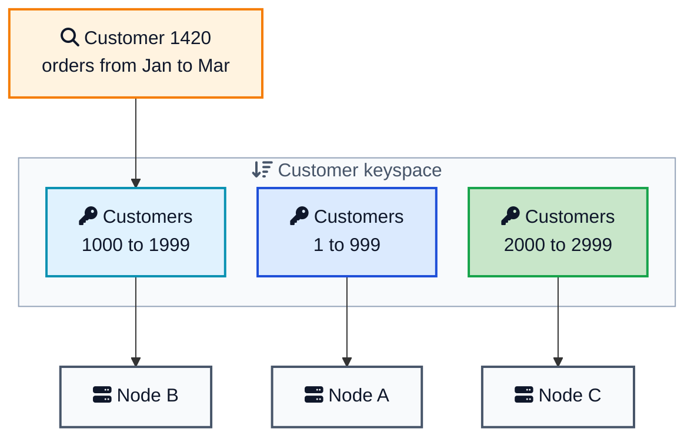
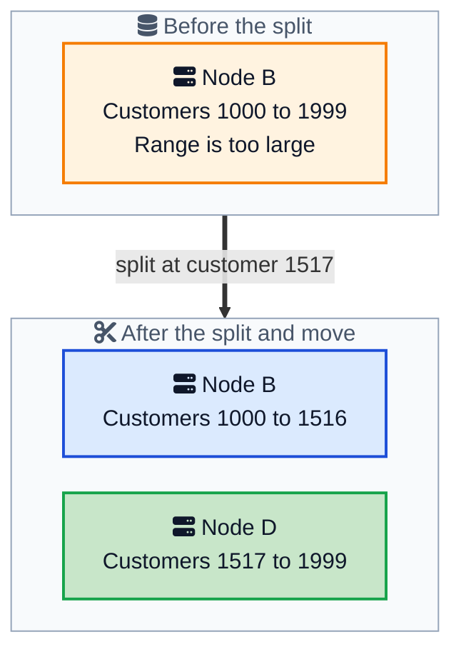

Monday, 9:12am. A customer opens the order history page and asks for the last 90 days. The request has already touched all 12 database nodes, and the page is still loading.

Fetching one order is fast. The system hashes `order_id`, so it can jump directly to the node that stores that order. But one customer's orders are scattered across the cluster. To build the timeline, the database must ask every node, merge the results, and wait for the slowest response.

The team needs a different layout. Orders from the same customer should stay together and remain sorted by time.

[Key range partitions](/glossary/key-range-partitions/){:target="_blank" rel="noopener"} provide that layout. They sort keys, cut the sorted keyspace into ranges, and assign each range to a node. A query contacts only the ranges that overlap what it needs.

That makes range queries fast, but it creates a new danger. If every new key is larger than the previous one, every write goes to the final range. One node becomes hot while the rest sit idle.

This post follows both parts of the story: why sorted ranges fix the customer timeline, and why the key design decides whether the solution will scale.



## <i class="fas fa-search"></i> Why Hashing Breaks Range Queries

Hashing works well when most requests look up one key. It spreads keys and writes across the cluster.

The cost appears when a query asks for a sequence:

- all orders for customer 42
- orders placed between two times
- the next 50 orders after a cursor

The router cannot infer where those rows live from their original values. It must ask every partition. This is a **scatter and gather** query: scatter the request across the cluster, then gather and merge the answers.

[Fixed Partitions](/distributed-systems/fixed-partitions/){:target="_blank" rel="noopener"} and [consistent hashing](/consistent-hashing-explained/){:target="_blank" rel="noopener"} both have this trade-off. They preserve hash order, not the natural order of the original keys.

## <i class="fas fa-sort-amount-down"></i> Keep Related Keys Together

Instead of hashing the whole key, sort the keys and cut the sorted line into ranges.

For the order history page, a useful key is:

```text
(customer_id, created_at, order_id)
```

All orders for customer 42 now sit next to each other. Inside that customer's section, orders are sorted by time. `order_id` makes the key unique when two orders have the same timestamp.

The database can divide the keyspace like this:

| Range | Contents | Node |
|---|---|---|
| `[customer 1, customer 1000)` | Customers 1 to 999 | Node A |
| `[customer 1000, customer 2000)` | Customers 1000 to 1999 | Node B |
| `[customer 2000, customer 3000)` | Customers 2000 to 2999 | Node C |

The notation `[1000, 2000)` includes 1000 but not 2000. These **half-open ranges** give every key exactly one home.





Customer 1420 falls inside the middle range, so the order history query goes to Node B. The database scans only that customer's rows and only the requested dates.

This is the main advantage of key range partitions: **data that is read together stays together**.

The same layout helps with prefix queries, pagination, and transactions that update several rows with the same key prefix.

A query can still cross ranges. Asking for customers 900 through 1100 touches Node A and Node B. The work grows with the requested part of the keyspace, not automatically with the size of the cluster.

## <i class="fas fa-route"></i> How the Database Finds a Range

The database keeps a small routing table of start keys, end keys, and owners. Because the boundaries are sorted, it can find the right range with a binary search.

Clients and database gateways cache this table. If a range has moved, the old owner returns the new location, the client refreshes its cache, and the request is retried.

The authoritative map must be strongly consistent. Otherwise two nodes may both believe they own the same range. Systems store the map in a [consistent core](/distributed-systems/consistent-core/){:target="_blank" rel="noopener"} or in special metadata ranges.

## <i class="fas fa-cut"></i> Splits and Merges Change the Number of Ranges

A new table may start as one range that covers every possible key. As data grows, that range becomes too large or too busy.

The database then:

1. Chooses a split key near the middle of the data.
2. Replaces the old range with two smaller ranges.
3. Updates the routing table.
4. Moves one new range to another node if needed.

Suppose Node B owns customers 1000 to 1999. It can split the range at customer 1517.





If the database uses an [LSM tree](/glossary/lsm-tree/){:target="_blank" rel="noopener"}, creating the boundary can be cheap because the files are already sorted. Moving one new range to another node is the expensive part.

Small neighboring ranges can also merge. This prevents the cluster from accumulating too many tiny ranges.

Real systems use different names and split sizes:

| System | Name | Typical behavior |
|---|---|---|
| [CockroachDB](https://www.cockroachlabs.com/docs/stable/configure-replication-zones){:target="_blank" rel="noopener"} | Range | Splits at 512 MiB by default |
| [TiKV / TiDB](https://docs.pingcap.com/tidb/stable/tune-region-performance/){:target="_blank" rel="noopener"} | Region | TiDB 8.4 targets 256 MiB by default |
| [HBase](https://hbase.apache.org/docs/architecture/regions/){:target="_blank" rel="noopener"} | Region | Uses a configurable size policy |
| [Bigtable](https://research.google.com/archive/bigtable-osdi06.pdf){:target="_blank" rel="noopener"} | Tablet | Splits tablets automatically |
| [Cloud Spanner](https://docs.cloud.google.com/spanner/docs/schema-and-data-model){:target="_blank" rel="noopener"} | Split | Changes boundaries based on size and load |

One operational detail matters: a new table may begin as one range on one node. For a large import, create several initial ranges first. This is called **pre-splitting**.

## <i class="fas fa-fire"></i> The Hotspot Hidden in Sorted Keys

The customer order key works because it starts with `customer_id`:

```text
(customer_id, created_at, order_id)
```

Many customers place orders at the same time, so writes spread across many customer ranges.

Now imagine an event table with this key:

```text
(created_at, event_id)
```

Every new timestamp is greater than the previous one. Every insert goes to the final range. Older ranges may serve reads, but they receive no new writes. One node handles the full write rate while the others wait.

This is the classic **hot range** problem.

Splitting does not solve it. The older half becomes quiet, while the newer half still receives every new write. The hotspot simply moves to the new final range.

### Fix 1: Put a well-distributed value first

For customer events, use:

```text
(customer_id, created_at, event_id)
```

Writes spread across customers, while each customer's events remain sorted by time.

### Fix 2: Add hash buckets

If the application truly needs a global time stream, add a bucket before the timestamp:

```text
(hash(event_id) % 16, created_at, event_id)
```

Writes spread across 16 buckets. A time query must scan all 16 buckets and merge the results. Better write distribution costs more read work.

[CockroachDB hash-sharded indexes](https://www.cockroachlabs.com/blog/hash-sharded-indexes-unlock-linear-scaling-for-sequential-workloads/){:target="_blank" rel="noopener"} automate this idea.

### Fix 3: Shard a single hot value

A single key cannot be split. If one counter receives thousands of updates per second, changing the surrounding boundaries will not help. Store several counter buckets and add them together when reading.

> A database can split ranges for you. It cannot choose a good key for you.

## <i class="fas fa-project-diagram"></i> One Range, One Consensus Group

A range is often more than a routing span. In CockroachDB, TiKV, and YugabyteDB, each range is replicated as its own Raft group. One replica leads writes while followers copy the [replicated log](/distributed-systems/replicated-log/){:target="_blank" rel="noopener"}.

This has two practical effects:

- Adding replicas improves availability, but does not increase the write throughput of one hot range.
- Splitting a range helps only when both halves receive traffic and one half can move to another node.

Spanner follows a similar idea with Paxos groups. A transaction inside one split is cheaper than a transaction across several splits, which needs [two-phase commit](/glossary/two-phase-commit/){:target="_blank" rel="noopener"}. Keep rows that change together close in the key order when possible.

Bigtable and HBase replicate storage differently, but a tablet or region is still the unit assigned to a server. A hot region can still overload that server.

## <i class="fas fa-server"></i> Range Partitioning Is Not Always Distributed Sharding

Several database features use the word "range," but they do not all do the same job.

**PostgreSQL [`PARTITION BY RANGE`](https://www.postgresql.org/docs/current/ddl-partitioning.html){:target="_blank" rel="noopener"}** splits one table into local child tables. It helps the query planner skip unrelated partitions and makes old data easy to remove. It does not place those partitions on different machines by itself.

```sql
CREATE TABLE orders (
    id          bigint,
    customer_id bigint,
    created_at  timestamptz NOT NULL
) PARTITION BY RANGE (created_at);

CREATE TABLE orders_2026_11 PARTITION OF orders
    FOR VALUES FROM ('2026-11-01') TO ('2026-12-01');
```

**[MongoDB ranged sharding](https://www.mongodb.com/docs/manual/core/ranged-sharding/){:target="_blank" rel="noopener"}** distributes ranges of a shard key across machines. A monotonically increasing shard key can create a hot shard. A hashed shard key spreads writes but makes range queries more expensive.

**[DynamoDB](https://docs.aws.amazon.com/amazondynamodb/latest/developerguide/HowItWorks.Partitions.html){:target="_blank" rel="noopener"}** hashes the partition key, then sorts items with the same partition key by a sort key. It can efficiently scan a sort-key range inside one partition key, but not across arbitrary partition keys.

All three show the same trade-off:

- Preserve key order for efficient range queries.
- Hash keys for more even distribution.
- Combine both for ordered reads inside a well-distributed prefix.

## <i class="fas fa-balance-scale"></i> Range, Hash, and Fixed Partitions

| | Key range partitions | Fixed partitions | Consistent hashing |
|---|---|---|---|
| Key placement | Sorted boundaries | Hash into a fixed partition count | Hash onto a ring |
| Range query | Reads overlapping ranges | Usually checks every partition | Usually checks many nodes |
| Sequential writes | Can create a hot final range | Spread out | Spread out |
| Adding a node | Move some ranges | Move some partitions | Move one arc of the ring |
| Partition count | Changes through splits and merges | Fixed at creation | Changes with ring membership |
| Best fit | Ordered scans and related rows | Even point reads and writes | Dynamic cache or storage nodes |

## <i class="fas fa-check-circle"></i> When This Is the Right Call

Use key range partitions when:

- queries read a key range or prefix
- related rows should stay together
- transactions usually touch rows with the same prefix
- writes are spread across many prefixes

Prefer hash partitioning when:

- most requests are point lookups
- keys increase over time and write throughput is high
- natural ordering does not help the queries
- even load matters more than scan locality

Many applications combine both ideas: a well-distributed prefix followed by a sorted value.

```text
(customer_id, created_at, order_id)
```

That key spreads writes across customers and keeps each customer's orders sorted.

## <i class="fas fa-exclamation-triangle"></i> Common Mistakes

### Using a timestamp as the first key field

This sends all new writes to the final range. Put a distributed field such as `customer_id` first, or add hash buckets.

### Assuming a split always fixes a hot range

A split helps only when traffic exists on both sides of the split key. It cannot divide one hot key or an append-only tail.

### Starting a large import with one range

Create initial boundaries before the import so several nodes can work from the start.

### Treating local table partitions as distributed shards

PostgreSQL `PARTITION BY RANGE` improves pruning and data management on one server. It is not horizontal scaling by itself.

### Choosing boundaries without looking at real keys

Equal ranges do not guarantee equal data. Sample realistic keys before pre-splitting.

## <i class="fas fa-tasks"></i> Key Takeaways for Developers

1. **Key range partitions keep sorted neighbors together.** This makes range and prefix queries efficient.
2. **The key order must match the query.** `(customer_id, created_at)` works for one customer's timeline.
3. **Ranges split and merge as data changes.** The number of ranges is not fixed.
4. **Sequential keys create a hot final range.** Splitting only moves the problem.
5. **Use a distributed prefix or hash buckets to spread writes.**
6. **One hot key needs application-level sharding.**
7. **Pre-split before a large import.**
8. **Range partitioning trades even distribution for query locality.**

## <i class="fas fa-flag-checkered"></i> Wrapping Up

The slow order history page did not need more servers. It needed related rows to live together.

Key range partitions solve that problem by sorting keys and assigning continuous sections to nodes. The customer timeline becomes a local scan instead of a request to the whole cluster.

But sorted order also controls where writes land. Put a timestamp first, and every new write goes to the final range. Put `customer_id` first, and writes spread across customers while each customer's history stays ordered.

That is the central lesson: choose the key from the queries you need and the traffic you expect. The database can split, merge, move, and replicate ranges. Only you can choose the order that makes those ranges useful.

---



**Related posts:**

- [Fixed Partitions Pattern](/distributed-systems/fixed-partitions/){:target="_blank" rel="noopener"} - The hash based cousin, with a frozen partition count, used by Kafka and Redis Cluster
- [Consistent Hashing Explained](/consistent-hashing-explained/){:target="_blank" rel="noopener"} - The ring based way to spread keys when you do not need sorted scans
- [How Google Ads Scales with Spanner](/how-google-ads-scales-with-spanner/){:target="_blank" rel="noopener"} - Splits, Paxos groups, and what a transaction pays when it crosses ranges
- [Wide Column Stores Explained](/wide-column-stores-explained/){:target="_blank" rel="noopener"} - Bigtable tablets and HBase regions on one side, Cassandra's hash ring on the other
- [Consistent Core Pattern](/distributed-systems/consistent-core/){:target="_blank" rel="noopener"} - Where TiKV's Placement Driver keeps the range directory
- [Follower Reads](/distributed-systems/follower-reads/){:target="_blank" rel="noopener"} - How a replica of a CockroachDB range answers a slightly stale read
- [Lease Pattern](/distributed-systems/lease/){:target="_blank" rel="noopener"} - The lease a CockroachDB leaseholder holds so a paused leader stops serving the range

*Further reading: Unmesh Joshi's [Key-Range Partitions chapter](https://martinfowler.com/articles/patterns-of-distributed-systems/key-range-partitions.html){:target="_blank" rel="noopener"} in Patterns of Distributed Systems; the [Bigtable paper](https://research.google.com/archive/bigtable-osdi06.pdf){:target="_blank" rel="noopener"}; [Spanner's schema docs on splits](https://docs.cloud.google.com/spanner/docs/schema-and-data-model){:target="_blank" rel="noopener"} and the [Life of Spanner Reads and Writes](https://docs.cloud.google.com/spanner/docs/whitepapers/life-of-reads-and-writes){:target="_blank" rel="noopener"}; [CockroachDB replication zones](https://www.cockroachlabs.com/docs/stable/configure-replication-zones){:target="_blank" rel="noopener"}; [TiDB region tuning](https://docs.pingcap.com/tidb/stable/tune-region-performance/){:target="_blank" rel="noopener"}; the [HBase region architecture](https://hbase.apache.org/docs/architecture/regions/){:target="_blank" rel="noopener"}; [YugabyteDB hash and range sharding](https://docs.yugabyte.com/stable/explore/going-beyond-sql/data-sharding/){:target="_blank" rel="noopener"}; and Chapter 6 of Martin Kleppmann's [Designing Data-Intensive Applications](https://dataintensive.net/){:target="_blank" rel="noopener"}.*
