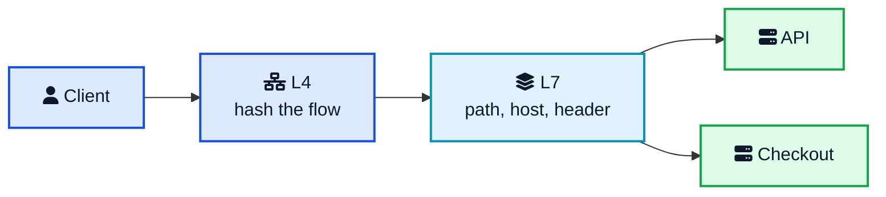
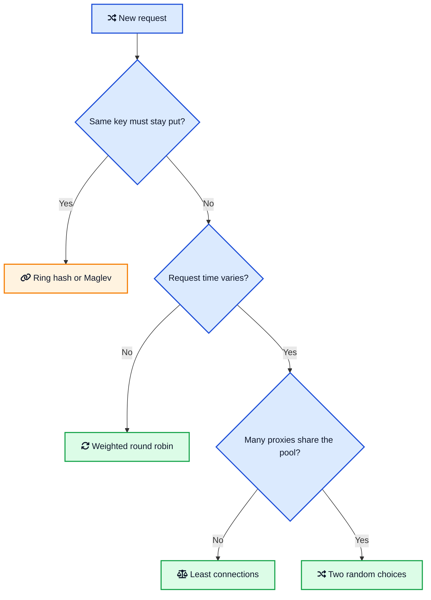
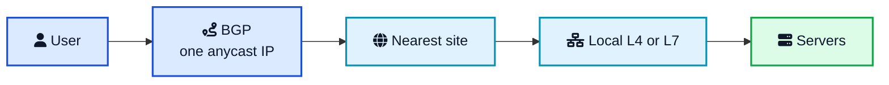
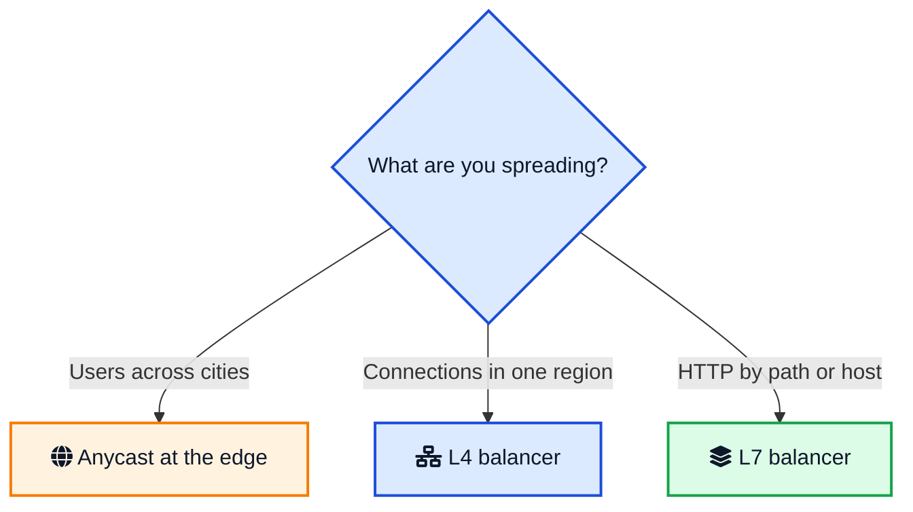

Three API servers sit behind one address. The dashboard says traffic is even: each machine gets the same number of requests. Two answer in about 20 milliseconds. The third, after its local cache goes cold, answers in about two seconds. The balancer keeps giving it a third of the new arrivals. Queues grow on that one box. The other two look idle. Users feel a slow site, and the graph that is supposed to explain it says the load is balanced.

That graph is counting arrivals, not work. This is the gap in a short version of [load balancing explained](/glossary/load-balancing/){:target="_blank" rel="noopener"}: spread the requests out, and you are done. A balancer can only act on what it is allowed to see, and the algorithm only optimizes the number you asked it to optimize.

The rest of this post follows that choice. Layer 4 or layer 7 decides whether the balancer sees a connection or a request. The algorithm decides whether you equalize arrivals, in-flight work, or a key. Health checks decide who is even a candidate. [Anycast](/glossary/anycast/){:target="_blank" rel="noopener"} answers a different question: which city, not which process.



## <i class="fas fa-sync"></i> Round Robin Keeps Feeding the Slow Server

[Round robin](https://nginx.org/en/docs/http/load_balancing.html){:target="_blank" rel="noopener"} is what produced that graph. It walks the three servers in order and never looks at how long the last request took. A server that is slow but still returns 200 stays in the rotation at a full share. The health check will not save you either, if all it checks is that 200.

It is still the right tool when requests really are uniform. NGINX uses it when you name no other method. HAProxy uses it when you do not set `balance`. An Application Load Balancer uses it unless the target group is switched to least outstanding requests.

Weights are the other thing round robin is good at. A server with `weight=3` beside two servers at the default weight of 1 receives 3 of every 5 requests. That is a canary, or a bigger machine, without a second cluster.

```nginx
upstream api {
    server 10.0.1.1 weight=3;
    server 10.0.1.2;
    server 10.0.1.3;
}
```

## <i class="fas fa-layer-group"></i> Load Balancing Explained at Layer 4 and Layer 7

L4 vs L7 load balancing is a question about what the balancer is allowed to read.

A **layer 4** balancer works on the connection. For TCP, AWS Network Load Balancer picks a target with a flow hash of the protocol, source IP, source port, destination IP, destination port, and TCP sequence number. That connection stays on the chosen target for its life. The next connection from the same client can land elsewhere, because the source port and sequence number changed. UDP is hashed without the sequence number, so one UDP flow stays on one target. QUIC traffic is pinned by the server id inside the connection id, after the first packet.

A **layer 7** balancer terminates HTTP (or gRPC) and reads the message. An Application Load Balancer walks listener rules in priority order, then picks a target in that rule's target group. The rules can match the path, the Host header, another header, the method, a query parameter, or the source IP. One listener can send `/api` to one group and `/checkout` to another. The same target can sit in more than one group.





Use L4 when you do not need the contents: packet rate, a static IP, TCP, UDP, QUIC. NLB can preserve the client IP, so the backend sees the real source. Use L7 when the URL routes, when you authenticate before the app, or when one port fronts several services. L7 has to read the request, usually after decrypting it, and the backend sees the proxy's address unless the proxy adds `X-Forwarded-For` or the PROXY protocol.

L4 cannot send one request to the API and the next to checkout. L7 can, which is why HTTP/2 still gets per-request routing. A WebSocket is the other way around: one long connection stays where it was accepted, and that socket should count as load.

To route on a path, someone must terminate TLS. ALB does. NLB can terminate TLS and still will not route on HTTP fields. Pass TCP through untouched when the backend must see the client certificate, and you do not need content rules.

Cross-zone is off by default on NLB. Each node sends traffic only to targets in its own Availability Zone, so a zone with more targets does not automatically get more traffic. If a zone has no healthy target, AWS removes that subnet's IP from DNS. Clients that ignore the TTL and keep the old IP fail. That leak shows up again with anycast.

| | Layer 4 | Layer 7 |
|---|---|---|
| Sees | IPs, ports, protocol | Path, host, headers, cookies |
| Balances | A connection or flow | A request |
| Typical fit | TCP, UDP, QUIC, static IP, raw throughput | HTTP routing, gRPC, auth, one port for many services |
| AWS example | Network Load Balancer | Application Load Balancer |
| Usual software | IPVS, Maglev, NGINX stream, HAProxy in TCP mode | NGINX, HAProxy, Envoy |

NGINX and HAProxy can sit in either column. Pick the row for the job, not for the binary.

## <i class="fas fa-random"></i> Load Balancing Algorithms

The algorithm picks which healthy target gets this connection or this request.

### Least connections

Least connections sends the next unit of work to the target with the fewest in flight. That is the fix for the cold server in the opening: it already has a deep queue, so new requests go to the other two until it drains.

NGINX turns it on with `least_conn`. HAProxy's `leastconn` also counts queued connections. The HAProxy manual recommends it for long sessions such as LDAP and SQL, and calls it a weak fit for short HTTP, where every server's connection count looks the same and the algorithm collapses back into round robin. Use it when duration varies: database calls, uploads, server-sent events, WebSockets. Skip it for a pool of identical 20 millisecond GETs.

```nginx
upstream api {
    least_conn;
    server 10.0.1.1;
    server 10.0.1.2;
    server 10.0.1.3;
}
```

ALB's least outstanding requests counts HTTP requests, not TCP sockets. On HTTP/2 one connection carries many requests, so a connection count lies. Open source NGINX stops at connection counts. NGINX Plus adds `least_time`, which also uses average latency. HAProxy's `roundrobin` can change weights on the fly for a slow start, and it caps a backend at 4,095 servers. A process that just joined has a cold cache. Give it a fraction of its weight until it warms.

### Power of two choices

Least connections fails in a new way once many balancers share a pool. Twenty Envoy sidecars each look for the least loaded host, agree, and all send the next request there. The pile then walks to the next host. Same shape as a [thundering herd](/thundering-herd-problem/){:target="_blank" rel="noopener"}: many actors react to one shared observation.

Power of two choices picks two healthy servers at random and sends the request to the less loaded one. The sidecars stop agreeing, and you almost never pick the worst server. Envoy does this by default for least-request when weights are equal (`N` is 2). HAProxy's `random` does the same, and the manual says two draws are enough. A much larger `N` becomes a slow scan. When weights differ, Envoy scales each host's weight down as its active requests rise.

Use two random choices for a mesh, a large proxy tier, or a sidecar per pod. Use plain least connections when one balancer can see the whole pool.

### Hashing that survives a resize

Sometimes you do not want balance. The same user should hit a warm cache, the same shard key should hit the database that owns it, and a WebSocket should not move.

NGINX `ip_hash` and HAProxy `source` hash the client IP and divide by the number of servers that are up. The client sticks, until you add or remove a server. HAProxy says what happens then: many clients move. That is modulo hashing, and it is a bad deploy, because one new machine remaps a large fraction of keys and dumps their caches.

[Consistent hashing](/consistent-hashing-explained/){:target="_blank" rel="noopener"} bounds that. Envoy's ring hash puts each host on a circle many times, in proportion to its weight, and walks clockwise from the key. Adding or removing one host out of N moves about 1/N of the keys.

Maglev, from Google's 2016 paper, swaps the ring for a fixed table. Envoy uses 65,537 slots, the paper's size for smaller clusters. Weight 1 beside weight 2 gets 21,846 slots and 43,691. Lookup is an index. Against a ring of 256K entries, Envoy measures about 10 times faster builds and about 5 times faster picks, and about twice as many keys moving when a host leaves. A bigger table shrinks that move.

Maglev has fronted Google since 2008. Routers spray packets across the balancer machines with equal-cost multipath (ECMP). Each machine hashes the flow onward, and connection tracking keeps an existing flow put even when the table is rebuilt. One machine in the paper could fill a 10 Gbps link with small packets. The paper says the same design provided network load balancing for Google Cloud.

Use ring hash or Maglev, not `ip_hash`, when servers come and go. Keep a connection table so a new map does not reset live TCP. Do not hash stateless traffic for comfort. A hash cannot shed a hot key.





## <i class="fas fa-thumbtack"></i> Sticky Sessions Are a Constraint

A sticky session is a hash with a cookie. The L7 proxy sets it so the next request names its server. L4 and `ip_hash` fall back to the client address. HAProxy will not even run `balance` if a persistence record already chose a server, so a stick silently overrides the algorithm.

Keep it while a process holds an in-memory login, or a shard owns the key. Do not default a stateless API to it. Popular clients pin load, and a drain waits on every stuck session. ALB can stick with its cookie or the app's. Turn that on for the one target group that needs it, then move the session to Redis, a database, or a signed cookie the client carries. Losing a machine should lose capacity, not users. Hash a user id if you hash at all. Client IP is weak: carrier NAT hides thousands of people behind one address, and a phone changes that address mid-session. HAProxy calls `source` a best effort for clients that refuse cookies.

## <i class="fas fa-heartbeat"></i> Health Checks Decide Who Is in the Pool

The algorithm only chooses among targets the check still calls healthy. A bad check sends traffic at a server that should be out, and it does so with perfect fairness.

Active checks are probes on a timer. AWS's networking guidance starts both ALB and NLB at a 30 second interval, five successes to mark a target healthy, and two failures to mark it unhealthy. Fit that to the process. A container that takes a minute to warm will flap if two quick failures pull it during startup.

What the probe proves matters more than the interval. A TCP check proves the port accepted a connection. It does not prove the process can answer, or that the database behind it is up. An HTTP check of `/` that always returns 200 is the same lie. Use a dedicated path that succeeds only when the target can serve, and prefer that HTTP probe even on an NLB whose listener is TCP.

Passive checks watch real traffic. Open source NGINX has these, not a background probe. `max_fails` is how many failed attempts inside `fail_timeout` mark a server down. The default is 1. After the timeout, NGINX tries the server again with a live request. `max_fails=0` turns the check off. Active application checks are a NGINX Plus feature. On open source, do not assume a prober exists.

Taking a target out of rotation does not close its sockets. NLB's deregistration delay defaults to 300 seconds in that same guidance. Short requests can use a shorter delay so a deploy finishes. Long-lived TCP should keep it, or explicitly drop connections on a failed target, or the rollout waits for the last WebSocket.

A check can also be the outage. A [write-up of the October 2025 US-East-1 incident](/aws-us-east-outage-october-2025/){:target="_blank" rel="noopener"} traces the failure to a network load balancer health check that marked healthy targets dead. DNS for DynamoDB then had nothing to answer with. Alarm when too many targets go unhealthy together, and do not let one region's checker be the only thing that can withdraw a dependency other regions need.

A [heartbeat](/distributed-systems/heartbeat/){:target="_blank" rel="noopener"} is the same signal between your own services: silence means stop sending. The probe is that heartbeat, until the path it calls starts lying.

## <i class="fas fa-globe"></i> Anycast Balances Cities, Not Servers

Everything above assumes the packet has already arrived at a building. Anycast chooses the building.

On a unicast network, one IP address means one destination. Routers hand the packet toward that address, and a traceroute from anywhere ends on the same machine. Anycast announces the same prefix from many sites. Routers deliver the packet to the announcement they prefer, which is often geographically close and is always the one BGP picks. Prince's 2011 primer draws that distinction. Cloudflare's later write-ups of ingress describe the same design.

Three properties follow. Users reach the closest site by BGP metrics, which is usually the fast path. If a site stops announcing the prefix, traffic moves without a DNS change. A distributed flood lands on many sites at once, which is why anycast shows up in [DDoS defense](/ddos-attack-and-protection/){:target="_blank" rel="noopener"}: the botnet is spread across every place that announces the address, instead of filling one link. A [CDN](/cdn-system-design/){:target="_blank" rel="noopener"} depends on the same fact. The edge only helps if the user actually arrives there.



DNS failover is the weaker cousin, and it is what NLB uses between zones. AWS removes an unhealthy zone's IP from DNS, and says a client that ignores the TTL and keeps the old address will fail. Resolvers and clients do ignore TTLs. Anycast does not wait on them. It waits until BGP prefers the next announcement. There is no single failover time in that. Operators tune routes so a prefix does not flap, because a flip mid-session delivers packets to a machine with no state for the connection. Prince's primer already called that tuning the hard part.

Anycast still does not pick a server. Inside the site you run L4 or L7. Google sprays packets across Maglev machines with ECMP, then each machine hashes to a backend. Cloudflare's Unimog, the L4 balancer at the edge, measures how loaded each server is and moves connections, because two connections do not cost the same CPU. Anycast got the user to the city. Unimog and Maglev do the rest.

It is also ingress only. Majkowski's 2022 write-up is direct: you cannot open an outbound connection from an anycast address and expect the reply to come home. The reply is routed to whichever site is closest to the sender, which may not be the site that sent the packet. Cloudflare keeps anycast for users and uses unicast, later shared across servers by port range, when its own machines fetch an origin. Copy only the ingress diagram and origin fetches look like packet loss.

Announcing the prefix yourself means an address block, an autonomous system number, and someone tuning BGP. For almost every team that is a CDN or a global cloud load balancer. Buy the anycast. Spend the design time on the algorithm and the check behind it. [DNS](/how-dns-works-complete-guide/){:target="_blank" rel="noopener"} still has to teach the client that address. It is a poor emergency brake, because a resolver or a pinned IP keeps using an address you already withdrew.

## <i class="fas fa-map-signs"></i> How to Choose

Put the pieces in the order traffic actually hits them.



Then pick the algorithm from the work, not from the product default.

- **Short, even HTTP, identical servers.** Round robin on an L7 proxy. Add weights for a canary or a larger instance.
- **Mixed request times, uploads, SQL, WebSockets.** Least connections, or ALB's least outstanding requests. One long socket should count.
- **Many proxies, one pool.** Power of two choices, so the sidecars do not herd.
- **A cache or a shard that must see the same key.** Ring hash or Maglev, plus connection tracking. Not `ip_hash` modulo.
- **In-memory sessions.** A stick, briefly, while you move the session to a store.
- **TCP, UDP, QUIC, or a static IP at high packet rates.** L4, and an HTTP health check if the target speaks HTTP.
- **Several services on one hostname.** L7 rules. Do not try to encode a URL in a port.
- **Users spread across regions.** Anycast from a CDN or a global load balancer, then a normal balancer in each region. On Kubernetes the inner half is a Service in front of pods, and an Ingress or Gateway for the L7 rules. The [Kubernetes architecture](/devops/kubernetes-architecture/){:target="_blank" rel="noopener"} post is the walkthrough.

If a backend is up, in the pool, and still failing calls, the balancer has done its job and the next tool is a [circuit breaker](/circuit-breaker-pattern/){:target="_blank" rel="noopener"} on the client. Health checks are slow on purpose. A breaker is how a caller stops waiting for the probe interval.

## <i class="fas fa-flag-checkered"></i> Wrapping Up

Go back to the three servers and the even graph. The balancer was not broken. It was counting what round robin counts, and it could not see that one server had become a hundred times slower. Load balancing is the sequence of questions that graph skips. What am I allowed to read, a packet or a request? What am I equalizing, arrivals or work in flight? Who is allowed into the pool? Which city should this user reach?

Balance the work, not the arrivals. Use the cheapest layer that can see the fact you need.

If you change one setting this week, make it the one your pool is getting wrong. Switch a variable-latency target group off round robin. Point the health check at a path that fails when the database is gone. Replace `ip_hash` with a consistent hash if deploys scramble your cache. And if you are drawing anycast boxes, draw the local balancer inside the site, and a separate unicast path for the connections you open yourself.

---



**Related posts:**

- [Consistent Hashing Explained](/consistent-hashing-explained/){:target="_blank" rel="noopener"}: the ring you want when a key must stay on one server across a resize
- [CDN System Design](/cdn-system-design/){:target="_blank" rel="noopener"}: anycast and edge caches, one level above the balancer in this post
- [How DNS Works](/how-dns-works-complete-guide/){:target="_blank" rel="noopener"}: why removing an IP from DNS is a slow way to fail over
- [DDoS Attack and Protection](/ddos-attack-and-protection/){:target="_blank" rel="noopener"}: how a flood hits L4, L7, and an anycast edge differently
- [Kubernetes Architecture](/devops/kubernetes-architecture/){:target="_blank" rel="noopener"}: Services and Ingress, the load balancer in front of pods
- [AWS US-East-1 Outage, October 2025](/aws-us-east-outage-october-2025/){:target="_blank" rel="noopener"}: a health check that marked healthy targets dead
- [Thundering Herd Problem](/thundering-herd-problem/){:target="_blank" rel="noopener"}: the stampede that power of two choices is designed to avoid
- [Circuit Breaker Pattern](/circuit-breaker-pattern/){:target="_blank" rel="noopener"}: what to do when a target is in the pool and still failing

*Further reading: AWS on the [Network Load Balancer](https://docs.aws.amazon.com/elasticloadbalancing/latest/network/introduction.html){:target="_blank" rel="noopener"} and the [Application Load Balancer](https://docs.aws.amazon.com/elasticloadbalancing/latest/application/introduction.html){:target="_blank" rel="noopener"}, the [AWS networking notes on health checks](https://github.com/aws/aws-networking-best-practices/blob/main/content/application-networking/load-balancing.md){:target="_blank" rel="noopener"}, [NGINX load balancing](https://nginx.org/en/docs/http/load_balancing.html){:target="_blank" rel="noopener"}, the [HAProxy balance algorithms](https://docs.haproxy.org/3.2/configuration.html#4.2-balance){:target="_blank" rel="noopener"}, [Envoy's load balancer docs](https://www.envoyproxy.io/docs/envoy/latest/intro/arch_overview/upstream/load_balancing/load_balancers){:target="_blank" rel="noopener"}, Google's [Maglev paper](https://research.google/pubs/maglev-a-fast-and-reliable-software-network-load-balancer/){:target="_blank" rel="noopener"}, and Cloudflare on [anycast](https://blog.cloudflare.com/a-brief-anycast-primer/){:target="_blank" rel="noopener"}, [why egress cannot be anycast](https://blog.cloudflare.com/cloudflare-servers-dont-own-ips-anymore/){:target="_blank" rel="noopener"}, and [Unimog](https://blog.cloudflare.com/unimog-cloudflares-edge-load-balancer/){:target="_blank" rel="noopener"}.*
