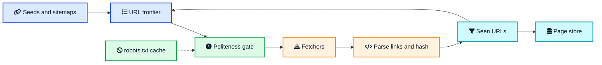
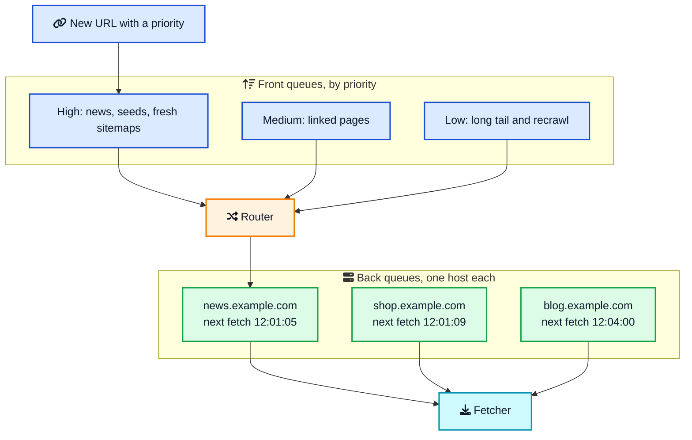

A web crawler can begin as twelve lines of Python: download a page, extract its links, and repeat. Point that script at a real site and three failures arrive quickly. It revisits the same URLs, sends a burst of requests to one host, and follows endless links such as a calendar's "next month" button.

The HTTP request is not the hard part. The hard part is deciding what the next request should be, when it is safe to send, and whether the crawler has already done the work.

This post grows that small script into a distributed crawler one failure at a time. You will see how a [URL frontier](/glossary/url-frontier/){:target="_blank" rel="noopener"} chooses the next page, how [robots.txt](/glossary/robots-txt/){:target="_blank" rel="noopener"} and a per host delay keep the crawler polite, how dedup stops repeated work, and how hostname sharding preserves those rules as machines are added. The same design appears in search engines, price monitors, and the [system design interview](/system-design-cheat-sheet/){:target="_blank" rel="noopener"} question "design a web crawler."



## <i class="fas fa-question-circle"></i> From One GET to a Web Crawler

A [web crawler](/glossary/web-crawler/){:target="_blank" rel="noopener"} is a program that discovers URLs, downloads the documents behind them, and remembers both the bytes and the links. Search is a later step. The crawler does not rank pages and it does not answer queries. It builds a corpus that some other system can index.

That split is worth holding onto, because people mix up three jobs:

- A **crawler** finds URLs and stores pages. Its success metric is a fresh, polite, deduplicated corpus.
- A **scraper** extracts fields from pages whose URLs you already know: a price, a title, a job posting. Web scraping tools sit on this side. They assume the URL list is solved.
- A **search index** turns stored pages into something you can query. Elasticsearch and OpenSearch are typical engines here. They consume the corpus. They should not be inside the fetch loop.

If your product is "watch these 200 product pages," you want a small polite fetcher plus a scraper. If your product is "find everything linked from these domains, and keep it fresh," you want the design in this post.

The web you are walking is a directed graph. Pages are nodes. Links are edges. A textbook breadth-first search on that graph works on a homework site and falls over on the real one, for reasons the rest of this post is about. The [graph traversal](/data-structures/graph/){:target="_blank" rel="noopener"} is still the skeleton. The production code is everything wrapped around it.

The first thing that breaks the textbook version is not code. It is arithmetic.

## <i class="fas fa-calculator"></i> The First Wall Is Scale

Marc Najork's crawler architecture write-up puts a concrete target on the table. To keep a corpus of about 10 billion pages fresh on a four-week cycle, the crawler has to download on the order of **4,000 pages a second**, all the time. That figure is from 2009 and it is a freshness budget, not a claim about today's Google. It is still the right way to feel the problem. A laptop loop that fetches one page, parses it, and then fetches the next will never get there, and it will get banned trying.

Do the arithmetic out loud in an interview. It signals you know which numbers matter.

| Question | Worked example |
| --- | --- |
| Fetch rate for 10 billion pages refreshed every 28 days | 10,000,000,000 / (28 × 86,400) ≈ 4,100 pages/sec |
| Bandwidth if the average HTML page is 100 KB | 4,100 × 100 KB ≈ 410 MB/sec of download |
| Hosts you must have in flight at 1 request/sec/host | about 4,100 hosts at once |
| RAM to store 1 billion raw URL strings at 100 bytes each | about 100 GB |
| RAM for a Bloom filter of 1 billion URLs at a 1% false positive rate | about 1.2 GB |

The last two rows are why dedup is a data structure problem and not a database lookup on every link. The hosts-in-flight row is why politeness dominates capacity planning. At one fetch per second per host, throughput equals the number of distinct hosts you are willing to touch right now. Buying more CPU does nothing if every worker is waiting on the same ten sites.

A focused crawler, one company, a few million pages, a refresh every day, is the same design with smaller constants. Maybe 50 pages a second and a few dozen machines. Do not skip the policy because the corpus is smaller. One host is enough for an uncontrolled script to trigger rate limits.

## <i class="fas fa-project-diagram"></i> Build the Smallest Durable Pipeline

Every durable crawler is the same loop with better plumbing:

1. Start from **seeds** (URLs you type in) and from **sitemaps** sites publish for you.
2. Put those URLs in the frontier.
3. Before the fetch, check robots.txt and the host's clock.
4. Download the URL with a hard timeout and a size cap.
5. Parse links and a content hash. Store the body.
6. Canonicalize the new links, drop ones you have seen, and send the rest back to the frontier.
7. Schedule the URL again later if it is worth keeping fresh.





The dotted arrow matters. The robots.txt cache is not a step in the happy path you can bolt on later. It is a check on the way out of the frontier, and a failed fetch of `/robots.txt` changes what you are allowed to do to that whole host.

Workers that fetch are stateless. They can run as ordinary processes, on virtual machines, or as a Kubernetes deployment. The state that must survive a restart lives in the frontier, the seen set, and the page store. If a worker dies mid-download, the URL goes back on the queue. That only stays correct if the fetch is safe to retry, which a GET of a public page is.

This loop is durable, but it still has one vague instruction: "take the next URL." A plain queue makes that instruction dangerous.

## <i class="fas fa-list-ol"></i> Why the URL Frontier Needs Two Queues

A frontier is the to-do list of the crawl. Early crawlers implemented it as a FIFO queue and did breadth-first search. That visits pages in the order you discovered them. It does not know that a newspaper front page should be refreshed every few minutes while a PDF from 2014 can wait months. It also does not know that the next five hundred URLs in the queue might all be on `cdn.example.com`.

One ordering cannot do both jobs. Priority wants important URLs near the head. Politeness wants every URL for one host grouped together and released on a timer. Heydon and Najork's Mercator crawler split the frontier into two stages so each job had its own queues. Najork's later architecture write-up keeps that split, and it is still the design to draw on a whiteboard.

**Front queues** hold URLs by priority. A high-priority queue gets seeds, sitemap URLs with a fresh `lastmod`, and pages that change often and attract links. A low-priority queue gets the long tail. You can implement the levels as a handful of real queues rather than one giant heap. A disk-based heap is painful, because every insert moves a lot of bytes. A few FIFO files, drained with a weighted pick (take from the high queue four times out of five, say), gives you priority without a seek on every URL.

**Back queues** hold URLs by host. All URLs for `news.example.com` sit in one queue. A small table remembers the earliest time that host may be fetched again. The scheduler's loop is short:

```text
pick the highest-priority back queue whose next_allowed <= now
url = pop(that queue)
hand url to a fetcher
next_allowed[host] = now + delay(host)
```

If every back queue is still cooling down, the scheduler waits. It does not "just grab something else" from a hot host. That wait is the product working.





Mercator kept the frontier on disk, with fixed memory buffers (their implementation buffered 600 URLs) so a crawl of hundreds of millions of URLs did not depend on RAM. Copy that idea: the head of each back queue can sit in memory, and the tail can sit in a log, RocksDB, or a [queue](/role-of-queues-in-system-design/){:target="_blank" rel="noopener"} partitioned by host. The scheduler only needs the head and the timestamp.

There is a second payoff. A slow host blocks only its own back queue. In a single shared queue, one host that takes 30 seconds to answer stalls every worker waiting behind it. Isolation is the reason to group by host, even before you care about being polite.

The two-level frontier fixes ordering. It also exposes the next problem: adding fetchers can make the crawler faster globally and more abusive locally.

## <i class="fas fa-handshake"></i> More Workers, More Risk: Politeness and robots.txt

Politeness is a correctness requirement. A crawler that is fast and rude gets a smaller corpus, because the sites worth crawling start returning 429 and 403, and then you have nothing.

Three separate rules get bundled under the word. Name them separately.

**Identify yourself.** Send a stable User-Agent whose product token is a real name, plus a URL where a human can read what you fetch and how to opt out. RFC 9309 expects that token to appear in both the HTTP header and the robots.txt group you obey. A crawler that pretends to be a browser is picking a fight with every site that publishes different rules for different agents.

**Obey robots.txt.** Before you fetch a URL on a host, fetch `https://host/robots.txt` if you do not have a fresh copy. Cache it. The [Robots Exclusion Protocol](https://www.rfc-editor.org/rfc/rfc9309){:target="_blank" rel="noopener"} became RFC 9309 in 2022, after almost thirty years as a de facto file format. The rules that matter:

- Match your product token to a `User-agent` group. If none matches, use the `*` group. If that is missing too, there are no rules.
- `Allow` and `Disallow` are path patterns. The longest match wins. If an Allow and a Disallow are the same length, Allow wins.
- The crawler chooses its own name. The site chooses the rules for that name.

Status codes are part of the protocol, and this is where homemade crawlers go wrong:

| robots.txt response | What RFC 9309 says | What Googlebot does |
| --- | --- | --- |
| 2xx | Parse the file and follow it | Parse the file and follow it |
| Redirects | Follow at least five hops. If the file is still not reached, treat it as unavailable | Follows at least five hops. If it is still redirecting, treats it as a 404 |
| 4xx | The file is unavailable, so crawling is allowed | 4xx except 429 means no restrictions |
| 5xx or a network error | The file is undefined, so assume a full disallow | Pauses crawling for 12 hours, then uses the last good copy for up to 30 days |

Google publishes the second column in [its robots.txt documentation](https://developers.google.com/crawling/docs/robots-txt/robots-txt-spec){:target="_blank" rel="noopener"}. If the file is still failing after those 30 days and the rest of the site answers, Google's documented fallback is to crawl as if there were no robots.txt, while still retrying the file. Cache the failure as well as the success. A host whose robots.txt returns 500 must not be probed again on every URL, or you have built a tight loop against a sick server. A [TTL](/glossary/ttl/){:target="_blank" rel="noopener"} around 24 hours matches both the RFC, which says not to trust a cached copy longer than that unless the file is unreachable, and Google's normal cache time. That cache is ordinary [caching](/caching-strategies-explained/){:target="_blank" rel="noopener"}: a fast copy, a bounded age, and a defined answer when the origin is down.

**Keep your own gap, per host.** `Crawl-delay` shows up in old blog posts as if it were part of the standard. It is not. Google's 2025 note on the protocol is explicit that `crawl-delay` is an extension some engines honor and Googlebot ignores. `Sitemap` is also outside RFC 9309, and unlike crawl-delay it is widely implemented, including by Google.

So write the delay yourself. Two published policies are enough to choose from:

- Mercator's default: at most one outstanding request to a host. The back queue gives you this for free if one worker owns the host.
- A time gap after each response. Najork describes waiting in proportion to how long the last download took, so a strained server gets more rest.

A practical default for a new crawler is one request at a time per host, and about one second between them, widened when you see 429, 503, or rising latency. That is [rate limiting](/dynamic-rate-limiter-system-design/){:target="_blank" rel="noopener"} with the host as the key. The interesting twist, compared with an API limiter, is that you are limiting *yourself* to protect someone else's server. Their 429 is a signal to lower the budget, which is also how Google describes [crawl capacity](https://developers.google.com/crawling/docs/crawl-budget){:target="_blank" rel="noopener"}: slow responses and 5xx or 429 answers shrink how hard Googlebot will press.

Google's name for the outcome is **crawl budget**. For them a "site" is a hostname, so `www.example.com` and `code.example.com` have separate budgets. Budget is capacity (what the host can take) times demand (how much the crawler wants fresh copies, from popularity, change rate, and the pile of known URLs). You will not reproduce Google's demand model. You can reproduce the idea: each host gets a ceiling, the ceiling drops when the host looks unhealthy, and duplicate URLs spend that ceiling on nothing.

Check robots rules at two moments. When you discover a link and you already have the file cached, drop disallowed URLs before they occupy frontier space. The first URL on a brand new host has nothing cached yet, so the fetcher pulls `/robots.txt` first and only then decides.

The crawler is now polite, but it can still waste most of its budget politely. The same page often wears many different URLs.

## <i class="fas fa-clone"></i> One Page, a Thousand URLs: Dedup

The web is full of URLs that are different strings and the same document. Session ids, `utm_source`, `http` versus `https`, a trailing slash, and a query string in a different order will all blow up a seen set that compares raw strings.

Canonicalize before any membership test. Do the boring transforms every time, in the same order:

```python
from urllib.parse import urlsplit, urlunsplit, parse_qsl, urlencode

TRACKING = {
    "utm_source", "utm_medium", "utm_campaign",
    "utm_term", "utm_content", "gclid", "fbclid",
}

def canonicalize(url: str) -> str:
    parts = urlsplit(url.strip())
    host = (parts.hostname or "").lower()
    port = parts.port
    scheme = (parts.scheme or "https").lower()
    if (scheme == "http" and port == 80) or (scheme == "https" and port == 443):
        port = None
    if ":" in host:  # IPv6
        host = f"[{host}]"
    netloc = host if port is None else f"{host}:{port}"
    query = [
        (k, v)
        for k, v in parse_qsl(parts.query, keep_blank_values=True)
        if k.lower() not in TRACKING
    ]
    query.sort()
    return urlunsplit((scheme, netloc, parts.path or "/", urlencode(query), ""))
```

The fragment (`#section`) is dropped because the server never sees it. The host is lowercased because DNS is case insensitive. Default ports are dropped so `:443` does not create a second identity. Query keys are sorted so `a=1&b=2` and `b=2&a=1` collide. Tracking parameters are stripped because they exist for analytics, not for content.

Leave a few decisions as explicit policy, and write them down:

- Do not blindly strip `www`. `www.example.com` and `example.com` can serve different sites. Follow redirects and record the host you actually landed on.
- Pick one trailing-slash rule and apply it everywhere, or let the redirect target become the canonical URL.
- Keep a denylist of parameters that are really session ids (`PHPSESSID` and friends). A parameter that changes the page, such as `product_id`, stays.

That function is [data deduplication](/glossary/data-deduplication/){:target="_blank" rel="noopener"} at the name layer. Two more layers sit under it.

**URL seen set.** You need "have we ever enqueued this canonical URL?" A hash set of full strings is exact and, at a billion URLs, enormous. A [Bloom filter](/data-structures/bloom-filter/){:target="_blank" rel="noopener"} answers the same question in about 1.2 GB for a billion URLs at a 1% false positive rate. A Bloom filter has a sharp contract: **no** means the URL is definitely new, **yes** means it might already be present. If you treat "yes" as truth, you will silently skip real pages. For a hobby crawl that can be acceptable. For a corpus someone pays for, confirm the positive in an exact store (RocksDB, Cassandra, a wide column store). Almost every check still finishes in memory. Only the "maybe" pays for a disk read.

A Bloom filter cannot delete. That is fine while the seen set only grows. If you later want to forget URLs that have been dead for a year, use a [cuckoo filter](/data-structures/cuckoo-filter/){:target="_blank" rel="noopener"}, which supports deletion, or rebuild the Bloom filter from the exact store.

**Content fingerprint.** Two canonical URLs can still be the same article syndicated twice. Hash the normalized body with a strong hash and store the bytes once, keyed by that hash. This is the same idea as content-addressed storage. Near duplicates (the same article plus a new ad, or a new timestamp in the footer) need a similarity hash rather than equality. Manku, Jain, and Das Sarma's paper on near-duplicate detection for web crawling shows how a short simhash fingerprint clusters those pages. You do not need this on day one. You do need a place in the pipeline where a content hash is computed, so adding near-duplicate detection later does not mean re-downloading the web.

Dedup has to happen *before* enqueue, not after fetch. Every duplicate you detect late has already spent crawl budget, bandwidth, and a politeness slot.

Once duplicates stop flooding the frontier, the remaining fetches become valuable. Each one still has to be bounded, cache-aware, and cheap to repeat.

## <i class="fas fa-download"></i> Make Every Fetch Earn Its Cost

The fetcher itself is the least interesting box and the easiest one to get stuck in.

**DNS.** At a few thousand hosts a second, DNS stops being free. Operating system resolvers are often single-threaded and slow under that fan-out. Mercator shipped its own resolver for this reason. Cache answers yourself, honor the DNS TTL, and bound negative caching so a typo in a sitemap does not get retried forever. The [DNS lookup path](/how-dns-works-complete-guide/){:target="_blank" rel="noopener"} is the same one a browser uses. A crawler does it for millions of names, so a cache hit is the difference between moving on and stalling in resolution.

**HTTP.** Prefer the canonical scheme you were redirected to, send your real User-Agent, and set a timeout on connect and on read. Cap the body. A response that is still streaming at 50 MB is not an HTML page you want in the parser. Cap redirects too, somewhere around five to ten hops, and refuse to follow a redirect onto a host whose robots.txt you have not checked. A redirect is how a polite fetch of a public URL becomes a fetch of somewhere you were told to stay out of.

**Conditional recrawl.** Save `ETag` and `Last-Modified`. On the next visit send `If-None-Match` and `If-Modified-Since`. A `304 Not Modified` means you refresh the timestamp and move on, without parsing a body you already have. Google's crawl budget guide calls this out because it saves their bandwidth and yours. Support it on both sides if you operate a site: it is one of the few crawl-budget levers that helps everyone.

**Parse defensively.** One bad page must not kill the worker. Limit parser time and memory, ignore links that are not `http` or `https`, and resolve relative URLs against the final URL after redirects, not the URL you started with. Extract text for the index later, in the indexer. The crawler can store the raw bytes.

**Write the bytes in a boring format.** Projects such as [Common Crawl](https://commoncrawl.org/){:target="_blank" rel="noopener"} store fetches as [WARC](https://iipc.github.io/warc-specifications/specifications/warc-format/warc-1.1/){:target="_blank" rel="noopener"} records: the request, the response headers, and the body, in a file you can replay. Putting those files in [Amazon S3](/how-amazon-s3-works/){:target="_blank" rel="noopener"} or any similar object store keeps the fetcher from knowing anything about search. A metadata row, in a database, points at the object and remembers status, hash, ETag, fetch time, and the next time this URL deserves a visit.

Sitemaps are a hint, not a boundary. The [sitemap protocol](https://www.sitemaps.org/protocol.html){:target="_blank" rel="noopener"} lets a host list up to 50,000 URLs in a file (50 MB uncompressed) and point at more files from an index. `lastmod` is a useful input to priority. A sitemap can be stale, incomplete, or full of URLs the site no longer wants fetched, so every sitemap URL still walks through robots.txt, canonicalization, and the seen set. Keep following links. A sitemap will not tell you about a page nobody remembered to list.

Eventually one machine runs out of network, disk, or file descriptors. Scaling out sounds like "add workers," but the wrong partition key destroys the politeness guarantee just built.

## <i class="fas fa-server"></i> Scale Out Without Losing Politeness

The mistake is to shard by URL hash. That spreads one host's URLs across every worker, and then politeness needs a shared lock or a shared rate limiter on every single fetch. You will get it wrong under retries.

Shard by **hostname**. Hash the host, assign the host to a worker, and that worker owns the back queue, the robots.txt entry, the DNS cache, and `next_allowed`. Politeness becomes a local variable. Najork points out a happy accident of the web: most links point at the same server they came from, so most newly discovered URLs are tested and enqueued locally. Only the cross-host links are forwarded, to the worker that owns the destination.

[Consistent hashing](/consistent-hashing-explained/){:target="_blank" rel="noopener"} is the right map from host to worker. When you add a machine, only the hosts whose ring position moves have to hand off their queues. A modulo hash would reshuffle almost every host, and for a while two workers would both believe they own `news.example.com`. That window is how you get banned during a deploy.

Handoff has to be exclusive. A simple approach that holds up:

1. The new owner learns the host is theirs.
2. The old owner stops popping that back queue and ships the remaining URLs, the robots cache, and `next_allowed`.
3. The new owner starts fetching only after it has installed that clock.

Until step 3 finishes, fetch nothing for that host. A short pause is cheaper than a double fetch storm.

The workers still need a shared seen set, or a seen set partitioned the same way as the hosts, with a forward step for foreign URLs. Partitioning the seen set by host matches the rest of the design: a URL's identity includes its host, and the owner is the only writer. Cross-host checks go to the owner and come back as "new" or "seen" before enqueue.

Page bodies do not need to live on the fetcher. Ship them to object storage, and publish a small message ("this canonical URL, this hash, this object key") onto a log such as [Kafka](/distributed-systems/how-kafka-works/){:target="_blank" rel="noopener"}. The indexer, the near-duplicate job, and the recrawl scheduler each consume that log at their own pace. The fetcher never waits for Elasticsearch. That queue is also your buffer when the index is down: crawling continues, indexing catches up.

A note on anycast and load balancers, because this comes up when people try to "just put the crawlers behind the same stack as the website." Anycast is for inbound user traffic. Your fetchers open outbound connections. Give them stable unicast addresses, a small pool of source IPs you can publish in your crawler documentation, and enough addresses that one blocked IP does not take the fleet with it. Rotating through thousands of addresses to dodge a block is how you become the thing robots.txt was invented to slow down. Do not build that.

The distributed crawl can now finish a pass. That victory lasts until the first page changes. A useful crawler is never truly done.

## <i class="fas fa-sync-alt"></i> The Crawl Never Finishes

Discovery and refresh are different schedules that share one politeness clock.

On the first visit you know almost nothing about importance. You do not have PageRank. You have the seed list, the sitemap, and the links you have seen so far. A usable stand-in is: pages linked from many places you have already crawled are more worth fetching soon than pages linked from one place. It is a biased estimate, and it is much better than pure FIFO, which spends the first week of a crawl on whatever site happened to be in the seed set's neighborhood.

After the first visit you know more. Store the content hash and the time. On a later visit, if the hash changed, the page is volatile. If it did not, stretch the interval. A news front page might come back hourly. A changelog that has been byte-identical for a year might come back monthly. Najork's summary of the goal is still the right one: spend fetches on pages that are high quality, in demand, and actually changing. A fast-changing page nobody links to, and a great page that never changes, both deserve less of the budget than the front page of a newspaper.

Model recrawl as URLs re-entering the front queues when `next_fetch_at` arrives, with a priority derived from that score. They land in the same back queues, so a refresh cannot cut in line ahead of politeness. The 304 path makes the common case cheap: most recrawls confirm nothing changed.

Google's public advice to large sites is the other side of this coin, and it is useful when you operate a site the crawler is visiting. Duplicate URLs waste the budget. `noindex` does not save it, because the crawler still has to fetch the page to see the tag. Blocking the junk in robots.txt does save it, because the crawler never requests those URLs. Returning 404 or 410 for pages that are really gone is a stronger "do not come back" signal than leaving them disallowed, since a disallowed URL stays in the queue and gets retried if the rule disappears.

## <i class="fas fa-exclamation-triangle"></i> Then the Web Pushes Back

A crawl trap is any generator of URLs that does not run out. Calendars, faceted shopping filters, "show 10 more" links with an offset, and a session id embedded in the path are the usual ones. Each URL is new to a string compare. The content is not.

Bounds beat cleverness here. Pick numbers as policy and put them in config:

- Maximum link depth from a seed, so a trap cannot walk forever even if every URL looks new.
- Maximum URLs accepted per host per day, so one trap cannot eat the cluster.
- Maximum URL length and maximum query parameters.
- A parameter denylist, maintained the way you maintain the tracking-parameter list.
- Maximum redirects, maximum bytes, maximum parse time.

Watch the metrics that reveal a trap even when a bound has not fired yet: a host whose URL count is growing linearly with fetch count, a host whose content hashes barely change, a queue depth for one host that never drains. Those three charts are the operational version of this section.

A few more failures that stall a fleet if you only test on your own blog:

- **Redirect loops and cross-host redirects.** Count hops. Re-check robots.txt when the host changes.
- **Huge or slow bodies.** The timeout has to cover silence, not just the TCP handshake. Release the worker. Widen that host's delay.
- **Malformed HTML and hostile compression.** A parser exception is a failed URL, not a dead process.
- **Retries that ignore politeness.** A 503 retry belongs at the back of that host's queue, at `next_allowed`, not on a global retry topic that fifty workers consume.
- **Seen set false positives treated as fact.** Measure the rate. If it climbs, the filter is full. Rebuild it larger. A scalable Bloom filter adds another filter when the first fills up. Using the full one and hoping is how you stop discovering pages.
- **Restart amnesia.** If the frontier and the seen set are only in RAM, a deploy recrawls the world and looks exactly like the twelve-line script. Durability is a politeness feature.

## <i class="fas fa-shield-alt"></i> The Threat Changes When a User Picks the URL

Everything above assumes you chose the seeds. The moment a user, a customer, or a model can hand your crawler a URL, you have built a [server-side request forgery](/glossary/ssrf/){:target="_blank" rel="noopener"} bug unless you constrain the fetch.

The request leaves from your network. An attacker who can choose the target can aim it at cloud metadata, at `http://127.0.0.1`, at an internal admin port, or at a host they are not supposed to reach. Redirects and DNS rebinding are how a URL that looked public at check time becomes an internal address at connect time.

For a multi-tenant crawler, a link preview, or a "import this page" feature:

- Allowlist schemes (`https` only, unless you have a reason).
- Resolve DNS and connect to the address you resolved. Refuse link-local, loopback, and private ranges.
- Apply the same check to every redirect hop.
- Keep this feature on separate source addresses and a separate robots.txt identity from any internal job.
- Give it a tiny per user rate limit. A customer who asks you to crawl the internet is a bill, and a weapon, if you let them.

A first-party crawl of seeds you control does not have this hole. A crawl of URLs you do not control has it on day one.

## <i class="fas fa-comments"></i> Tell the Same Story in an Interview

Forty-five minutes is enough if you keep the order. Interviewers are listening for the constraints, not for a brand name.

1. **Scope.** Web scale or a set of sites? HTML only, or images and PDF? One shot, or continuous refresh? Say which one you are designing. Continuous refresh of public HTML is the interesting case.
2. **Numbers.** Pages, refresh interval, pages per second, bandwidth, hosts in flight at your politeness gap. Use the table above and label every figure as an assumption.
3. **The picture.** Seeds, frontier, politeness, fetch, parse, seen set, object store, queue to the index. Draw it once.
4. **Frontier.** Front queues for priority, back queues for hosts, a next-allowed time. Say why one queue fails.
5. **Politeness.** robots.txt cache, User-Agent, your own delay, backoff on 429 and 5xx. Mention that crawl-delay is not in the RFC.
6. **Dedup.** Canonical URL, Bloom filter plus exact confirm, content hash. Say what a false positive costs.
7. **Scale-out.** Consistent hash on the hostname, not on the URL. Handoff pauses the host.
8. **Traps and freshness.** Depth and per host caps. Recrawl with 304s. Priority from change rate once you have history.
9. **What you would measure.** Fetch success rate, 429s per host, queue delay, Bloom false-positive checks, time since last fetch for high-priority pages.

If the interviewer pushes, the deep ends are: confirming Bloom positives, exclusive host handoff, and near-duplicate simhash. You do not need a custom TCP stack.

## <i class="fas fa-flag-checkered"></i> Wrapping Up

The twelve-line script at the start was not missing a better HTTP library. It was missing policy. Downloading is one box in the pipeline, and it is the box you should write last.

A crawler that can run for months is a policy engine with an HTTP client attached. The frontier decides what is worth doing. The per host clock decides when. robots.txt decides whether. The seen set decides whether you already did it. Consistent hashing decides which machine is allowed to make that decision for a given host. Object storage and a queue decide that search can happen later, on a different failure domain.

Get those right and the crawler can grow without becoming wasteful or rude. Get them wrong and extra workers only repeat the same mistakes faster, from more addresses, with a disk full of the same homepage.

---



**Related posts:**

- [System Design Cheat Sheet](/system-design-cheat-sheet/){:target="_blank" rel="noopener"}: the building blocks this design sits on, from queues to storage
- [Bloom Filter Explained](/data-structures/bloom-filter/){:target="_blank" rel="noopener"}: the seen-URL test, and what a false positive actually means
- [Cuckoo Filter](/data-structures/cuckoo-filter/){:target="_blank" rel="noopener"}: the membership filter to reach for when the seen set must delete
- [Consistent Hashing Explained](/consistent-hashing-explained/){:target="_blank" rel="noopener"}: how hosts move onto new workers without a full reshuffle
- [Dynamic Rate Limiter System Design](/dynamic-rate-limiter-system-design/){:target="_blank" rel="noopener"}: the same "budget per key" idea, from the server's side
- [Role of Queues in System Design](/role-of-queues-in-system-design/){:target="_blank" rel="noopener"}: why the frontier and the index should not share a process
- [How DNS Works](/how-dns-works-complete-guide/){:target="_blank" rel="noopener"}: the lookup a crawler does millions of times
- [How Amazon S3 Works](/how-amazon-s3-works/){:target="_blank" rel="noopener"}: a typical home for the raw page bodies
- [Graph Data Structure](/data-structures/graph/){:target="_blank" rel="noopener"}: the web is a graph, and BFS is only the start

*Further reading: Marc Najork's [Web Crawler Architecture](https://marc.najork.org/papers/eds2009a.pdf){:target="_blank" rel="noopener"}, Heydon and Najork's [Mercator paper](https://www.cs.ucr.edu/~vagelis/classes/CS242/publications/scalable-crawler.pdf){:target="_blank" rel="noopener"}, [RFC 9309](https://www.rfc-editor.org/rfc/rfc9309){:target="_blank" rel="noopener"}, Google's [robots.txt spec](https://developers.google.com/crawling/docs/robots-txt/robots-txt-spec){:target="_blank" rel="noopener"} and [crawl budget guide](https://developers.google.com/crawling/docs/crawl-budget){:target="_blank" rel="noopener"}, the [sitemap protocol](https://www.sitemaps.org/protocol.html){:target="_blank" rel="noopener"}, and Manku, Jain, and Das Sarma on [near-duplicate detection](https://research.google/pubs/detecting-near-duplicates-for-web-crawling/){:target="_blank" rel="noopener"}.*
