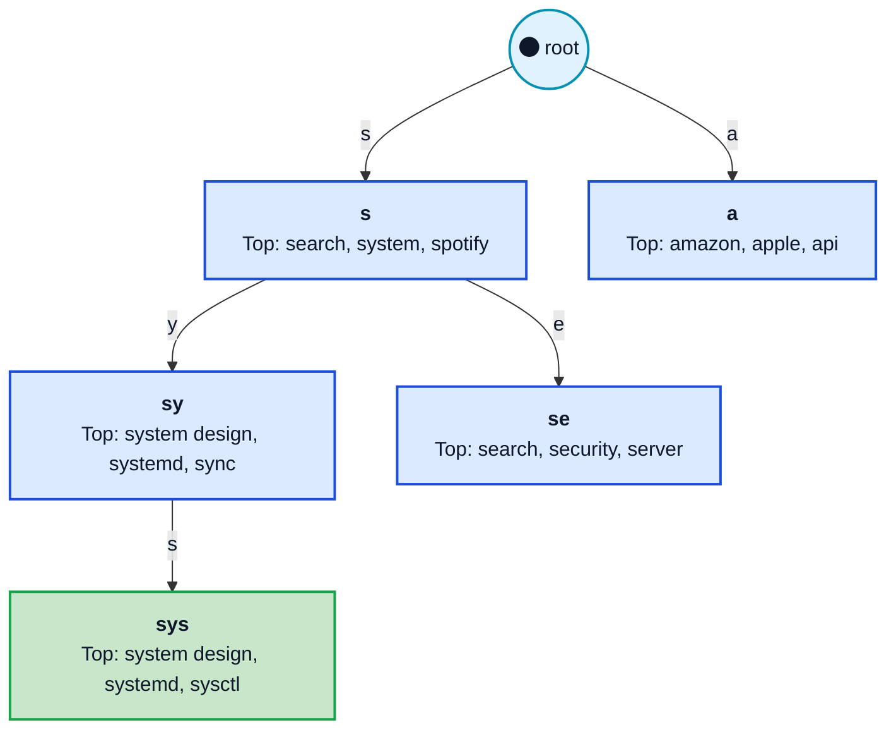
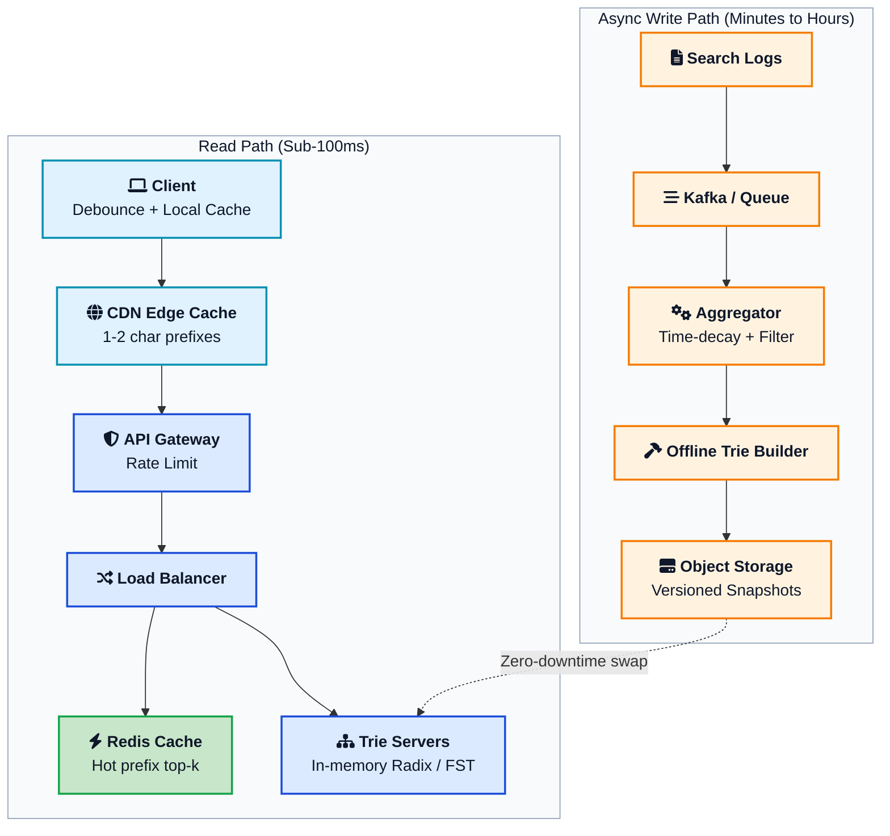
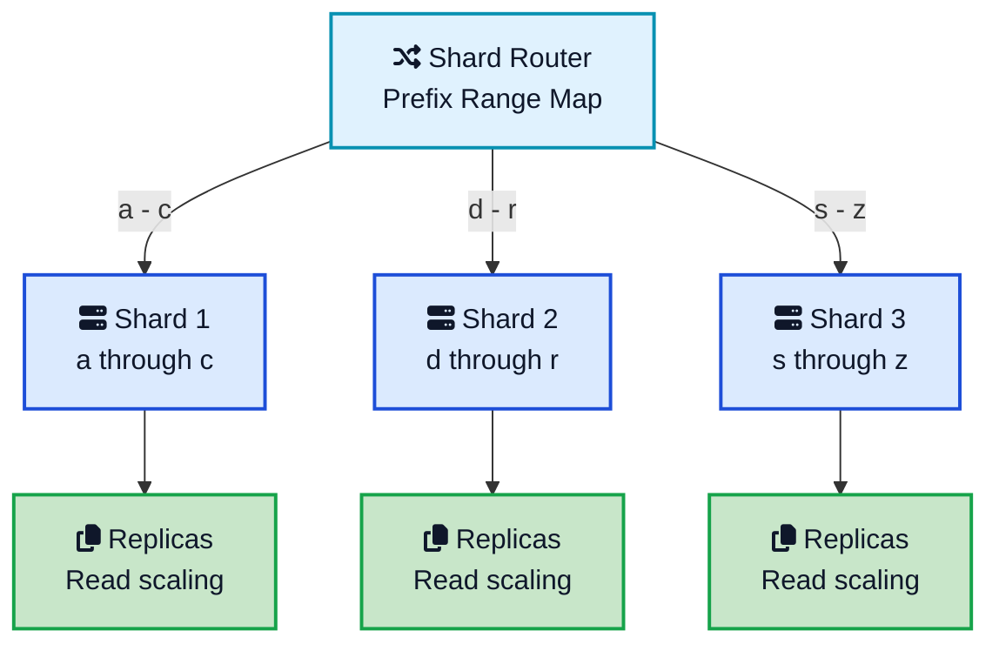

Type `sys` into a search bar. Before your finger lifts off the `s`, a dropdown appears with ten ranked suggestions: `system design`, `system design interview`, `systemd`, `sysctl`. Type one more letter, `t`, and the list reshapes itself before you even notice a pause.

Behind that simple dropdown is a traffic multiplier that surprises most engineers the first time they build one. A normal search happens once, when the user presses Enter. Autocomplete fires on every keystroke. A five-character query turns one search into five backend requests, and users expect every single one of them back in under 100 milliseconds.

If you point that traffic at a relational database running `SELECT query FROM searches WHERE query LIKE 'sys%' ORDER BY count DESC LIMIT 10`, the database falls over long before your product gets famous. This post walks through **search autocomplete system design** from first principles: the math that breaks naive queries, the [trie](/glossary/trie/){:target="_blank" rel="noopener"} trick that makes lookups instant, how to scale and shard it across machines, and when to skip building a custom trie altogether.



## <i class="fas fa-keyboard"></i> Why Autocomplete Is Harder Than Regular Search

Google estimates that [autocomplete reduces typing by about 25%](https://blog.google/products-and-platforms/products/search/how-google-autocomplete-works-search/){:target="_blank" rel="noopener"} and saves over 200 years of typing time every day. Users are conditioned to expect instant feedback. Once latency crosses 100 to 150 milliseconds, the dropdown feels sluggish, and by the time suggestions arrive, the user has already typed two more letters.

The second catch is asymmetry. Read traffic is huge, bursty, and latency-sensitive. Write traffic (updating how popular each search term is) does not need to happen synchronously at all. Nobody notices if a brand-new search phrase takes ten minutes or two hours to climb into the top ten suggestions, as long as yesterday's popular terms respond in 10 milliseconds.

That asymmetry is the single most important design insight in the whole system: **separate the read path from the write path completely**.

## <i class="fas fa-calculator"></i> Back-of-the-Envelope Capacity Math

Before picking a data structure or a cloud architecture, put real numbers on the table. Assume a mid-to-large web product with **10 million daily active users (DAU)**.

| Metric | Estimate | Why it matters |
| --- | --- | --- |
| Daily active users | 10 million | Starting scale |
| Searches per user per day | 4 searches | 40M completed searches/day |
| Average characters typed before clicking | 6 characters | Each search triggers ~6 autocomplete calls |
| Total autocomplete requests/day | 240 million | 6x multiplier over normal search |
| Average QPS | ~2,800 QPS | 240M / 86,400 seconds |
| Peak QPS (3x average) | ~8,500 QPS | Before client debouncing or CDN caching |
| Unique query strings stored | 50 million | After dropping one-off typos |
| Average query length | 20 bytes | ~1 GB of raw string data |

Look closely at the last two rows. The raw strings for 50 million unique queries take only about **1 GB**. Even if you triple or quadruple that for tree pointers, weights, and cached top-k lists, the entire index is measured in gigabytes, not petabytes. It fits in RAM.

Now look at the QPS row. Without caching or debouncing, 8,500 QPS hitting a disk-backed SQL table with `LIKE` prefix scans and `ORDER BY` sorting will burn CPU fast. And at Google or Amazon scale (hundreds of thousands of QPS), disk I/O is completely out of the question. Everything on the read path must live in memory.

## <i class="fas fa-sitemap"></i> The Core Data Structure: Trie With Cached Top-k

A [database index](/database-indexing-explained/){:target="_blank" rel="noopener"} like a B-tree can find strings starting with `sys`, but at high QPS you still have to scan a range of matching keys and sort them by popularity. A **trie** (prefix tree) removes the scan. Each edge represents one character, and walking from the root along `s` -> `y` -> `s` takes **O(p)** time, where `p` is the prefix length. Whether your dictionary holds 10,000 queries or 50 million, finding the node for `sys` takes three pointer hops.

There is a catch, though. Finding the `sys` node only puts you at the top of a subtree. If 200,000 queries start with `sys`, walking that entire subtree and sorting 200,000 frequencies on every keystroke is still way too slow.

The fix is simple: **precompute and cache the top-k suggestions inside every node**. When a user types `s`, the `s` node already holds an array of the top 5 or 10 queries starting with `s`. One node lookup returns the final ranked list in **O(p)** time, with zero sorting at query time.



### How top-k caching works in code

Instead of traversing thousands of descendant nodes on every keystroke, each `TrieNode` maintains a small sorted list of `(score, query_id)` pairs. During offline indexing, every time a query is inserted, its score bubbles up along the prefix path:

```python
class TrieNode:
    def __init__(self):
        self.children = {}
        self.top_k = []  # Sorted list of (score, query) tuples, max size k

def insert(root: TrieNode, query: str, score: int, k: int = 10) -> None:
    node = root
    for ch in query:
        if ch not in node.children:
            node.children[ch] = TrieNode()
        node = node.children[ch]

        # Update top-k cache at this prefix node
        updated = {q: s for s, q in node.top_k}
        updated[query] = max(updated.get(query, 0), score)
        node.top_k = sorted(
            ((s, q) for q, s in updated.items()),
            reverse=True,
        )[:k]

def autocomplete(root: TrieNode, prefix: str) -> list[str]:
    node = root
    for ch in prefix:
        if ch not in node.children:
            return []
        node = node.children[ch]
    return [q for _, q in node.top_k]
```

Look at `autocomplete()`. There is no recursion, no priority queue, and no subtree walk. If `prefix` is `"sys"`, the CPU follows three hash map lookups and returns `node.top_k` directly.

### Controlling memory bloat

That simple Python example hides a real production problem: **memory overhead**. A naive trie with 50 million 20-character queries can easily create 300 million+ nodes. If each node allocates a hash map or a 26-pointer array plus a 10-element `top_k` list of raw strings, pointer and object metadata alone will eat **20 GB to 40 GB of RAM** per replica.

Four practical optimizations shrink that footprint into a few gigabytes:

1. **Store integer query IDs, not full strings, at internal nodes.** Put the actual query strings in a flat string table (or arena buffer) once. Internal nodes only store compact 32-bit integer IDs and scores in their `top_k` arrays.
2. **Compress single-child chains into a radix tree (Patricia trie).** If `systemati` only leads to `systematic`, collapse those nine single-child nodes into one edge labeled `systemati`. That slashes node count and pointer chasing.
3. **Pack into a Finite State Transducer (FST) or flat byte array.** Instead of millions of heap-allocated objects (which trigger long garbage collection pauses in Java or Go), serialize the trie into a contiguous byte array or memory-mapped (`mmap`) file. An FST goes one step further by sharing common suffixes as well as common prefixes.
4. **Cap prefix depth.** Most users type 1 to 20 characters before clicking a suggestion. [Elasticsearch's completion suggester](https://www.elastic.co/docs/reference/elasticsearch/rest-apis/search-suggesters){:target="_blank" rel="noopener"} caps indexed input length at 50 UTF-16 code points by default for this exact reason: long tail prefixes waste memory and almost nobody autocompletes a 90-character sentence.

| Data Structure | Lookup Time | Memory Footprint | Suffix Sharing | Best Use Case |
| --- | --- | --- | --- | --- |
| Standard Trie + Top-k | `O(p)` | High (many pointers) | No | Small catalogs, learning |
| Radix Tree (Compressed Trie) | `O(p)` | Medium | No | Custom in-memory services |
| Finite State Transducer (FST) | `O(p)` | Very Low | Yes | Large search indexes (Lucene) |

## <i class="fas fa-project-diagram"></i> End-to-End Autocomplete Architecture

With the data structure settled, here is how the full system fits together across the read path and the write path.





### How the read path stays fast

Every millisecond between a keystroke and the dropdown matters. A fast read path wins before a single byte even hits your trie servers:

1. **Client-side debouncing and request cancellation.** Wait 100ms to 150ms after the user stops typing before firing a request. Just as important, cancel any in-flight HTTP request when a new character arrives. Without cancellation, a slower network response for `"sy"` can arrive *after* the faster response for `"sys"` and overwrite the dropdown with stale results:

```javascript
let activeController = null;
let debounceTimer = null;

function onSearchInput(query) {
  clearTimeout(debounceTimer);
  if (query.trim().length === 0) return;

  debounceTimer = setTimeout(async () => {
    if (activeController) activeController.abort();
    activeController = new AbortController();

    try {
      const res = await fetch(`/api/suggest?q=${encodeURIComponent(query)}`, {
        signal: activeController.signal,
      });
      const suggestions = await res.json();
      renderDropdown(suggestions);
    } catch (err) {
      if (err.name !== "AbortError") throw err;
    }
  }, 120);
}
```

2. **Browser and CDN edge caching.** Single-letter and two-letter prefixes (`a`, `s`, `we`) account for a massive percentage of autocomplete traffic and change slowly. Returning `Cache-Control: public, max-age=3600, stale-while-revalidate=60` lets browsers and a [CDN](/cdn-system-design/){:target="_blank" rel="noopener"} serve those hot prefixes from the edge, often absorbing 50% to 70% of total QPS before your origin sees a packet.
3. **API Gateway and Load Balancing.** An API gateway enforces [rate limiting](/dynamic-rate-limiter-system-design/){:target="_blank" rel="noopener"} so scrapers cannot dump your entire dictionary by walking `aa`, `ab`, `ac`. A [load balancer](/load-balancing-explained/){:target="_blank" rel="noopener"} routes requests over persistent HTTP/2 or gRPC connections to stateless query workers or prefix-specific trie shards.
4. **In-memory cache and Trie servers.** A distributed [caching](/caching-strategies-explained/){:target="_blank" rel="noopener"} layer (such as Redis) holds hot prefixes with a short [TTL](/glossary/ttl/){:target="_blank" rel="noopener"}, while the trie servers hold the full compressed trie in RAM. Keeping the JSON response payload under 1 KB (just the top 5 to 10 strings and optional type metadata) keeps serialization and network transfer under a millisecond.

### How the write path stays safe and fresh

Updating a live, multi-gigabyte trie in place on every search query would require locks or complex concurrent tree mutations, which kills tail latency on reads. Instead, treat the trie as **immutable** on the read servers:

1. **Sample and log completed queries.** Only log queries when a user actually presses Enter or clicks a suggestion, never partial prefixes like `sy`. At high scale (hundreds of millions of searches per day), you can sample 10% to 20% of logs for head queries while keeping full counts or sketch-based tracking for emerging terms.
2. **Aggregate with time decay.** If you rank purely by all-time search count, `"world cup 2022"` will beat `"world cup 2026"` for years. A [stream processing](/stream-processing/){:target="_blank" rel="noopener"} or periodic batch job applies exponential time decay so recent searches carry much higher weight:

$$\text{score}(q) = \sum_{t} \text{count}(q, t) \cdot e^{-\lambda (t_{\text{now}} - t)}$$

   In practice, many teams use a simpler discrete version: multiply yesterday's score by `0.9` and add today's search count. That gives a smooth 10-day half-life with one line of arithmetic.
3. **Filter before building.** Strip profanity, hate speech, personal data (emails, phone numbers, credit card patterns), and legal takedowns before the trie is built. Also drop one-off typos (for example, queries seen fewer than 5 times in the last week) so noise never bloats RAM.
4. **Build offline and swap atomically.** An offline worker builds the new compressed trie snapshot, runs automated sanity checks (ensuring the top 1,000 benchmark prefixes still return valid results), and uploads the serialized binary file to object storage (like S3). Read servers download the file, memory-map (`mmap`) it into RAM alongside the old snapshot, flip an atomic pointer, and unmap the old file. Zero downtime, zero write locks, and instant rollback if a bad snapshot slips through.

## <i class="fas fa-server"></i> Sharding, Replication, and Hot Prefixes

If your dictionary grows to hundreds of millions of queries and no longer fits on one machine, you need [sharding](/glossary/sharding/){:target="_blank" rel="noopener"}.

Do **not** hash the full query string to pick a shard. At query time you only have a prefix (`sys`), not the full query (`system design`). If `system design` hashed to shard 3 and `systemd` hashed to shard 7, every prefix lookup would have to fan out to all shards.

Instead, shard by **prefix range**. Keep a small routing table in the API layer or ZooKeeper/etcd:





A naive split like `A-M` and `N-Z` creates severe hot spots because far more words and queries start with `s` or `c` than `x` or `z`. Use historical query logs to split ranges by traffic volume and memory size: for example, `sa-sk` on Shard 1, `sl-sz` on Shard 2, and `u-z` sharing Shard 8. Track the range-to-shard map in a lightweight coordination store (ZooKeeper or etcd) and cache it on the API gateway.

Notice the trade-off: **prefix-range sharding only works for left-anchored prefixes**. If you later add infix matching (matching `"design"` inside `"system design"`), the router cannot tell which shard holds `"design"` without either indexing suffix tokens into their respective prefix shards or fanning out the query to all shards.

If you also shard a Redis prefix cache, [consistent hashing](/consistent-hashing-explained/){:target="_blank" rel="noopener"} prevents massive cache misses when cache nodes are added or removed.

For **replication**, each shard runs multiple read replicas across availability zones. Because snapshots are built offline and pulled by replicas, adding capacity for a traffic spike is as simple as booting more stateless read replicas that load the latest snapshot from object storage.

## <i class="fas fa-bolt"></i> Real-World Alternatives: When Not to Build a Custom Trie

In a system design interview, drawing a trie with cached top-k lists is expected. In production at a real company, you should ask whether you need to maintain a custom trie cluster at all. Two battle-tested tools solve this out of the box for most teams:

### 1. Elasticsearch Completion Suggester (FSTs)

As Elastic explains in their [You Complete Me](https://www.elastic.co/blog/you-complete-me){:target="_blank" rel="noopener"} engineering post, Lucene's `completion` suggester stores suggestions in an in-memory **weighted Finite State Transducer (FST)** built per index segment at index time. An FST is a directed graph that shares both common prefixes and common suffixes, making it much smaller in RAM than a naive pointer-based trie while still serving lookups in a few milliseconds. If you already run Elasticsearch or OpenSearch for search, using its completion suggester avoids operating a second distributed system.

### 2. Redis Sorted Sets (`ZRANGEBYLEX`)

For catalogs under a few million terms (like product names, user handles, or tags), [Redis sorted sets with `ZRANGEBYLEX`](https://redis.io/docs/latest/commands/zrangebylex/){:target="_blank" rel="noopener"} (or `ZRANGE ... BYLEX` in Redis 6.2+) give you prefix autocomplete in under a millisecond with zero custom tree code. Insert every term with score `0` so Redis sorts them lexicographically, then query the range `[prefix` to `[prefix\xff`:

```redis
ZADD autocomplete 0 "system design" 0 "systemd" 0 "sysctl" 0 "search"
ZRANGE autocomplete "[sys" "[sys\xff" BYLEX LIMIT 0 10
```

The main limitation of `ZRANGEBYLEX` is ranking: because all members must share score `0` for lexicographical sorting to work, you cannot rank by popularity inside the same sorted set. Teams work around this by either bucketing popular terms into separate keys or using a [Redis secondary index pattern](https://redis.io/docs/latest/develop/clients/patterns/indexes/){:target="_blank" rel="noopener"} where the top-k results for common prefixes are cached in a plain hash.

| Approach | Lookup Latency | Memory Efficiency | Ranking Support | Operational Effort |
| --- | --- | --- | --- | --- |
| SQL `LIKE 'prefix%'` | Slow under load | Disk-backed | Native (`ORDER BY`) | Low |
| Custom Trie + Top-k | Sub-5ms | Low unless compressed | Precomputed per node | High |
| Elasticsearch FST | Single-digit ms | High (shared prefixes + suffixes) | Index-time `weight` | Medium |
| Redis `ZRANGEBYLEX` | Sub-2ms | Medium | Requires extra layer | Low |

## <i class="fas fa-filter"></i> Production Details That Matter

Once the core architecture is solid, five practical problems decide whether the autocomplete bar feels smart or broken in production:

### 1. Real-time trending queries (Lambda-style merge)

A batch trie rebuilt every 6 hours cannot surface breaking news, a live sports score, or a sudden outage in 5 minutes. Instead of rebuilding the entire 50-million-query trie continuously, run a lightweight [stream processing](/stream-processing/){:target="_blank" rel="noopener"} job over a 5-minute sliding window of search logs. Store only the top few thousand spiking queries in a tiny "hot trends" in-memory cache or Redis key. At query time, the API layer reads `top_10` from the main trie and `top_5` from the hot-trends cache in parallel, merges and deduplicates them, and returns the final ranked list.

### 2. Personalization and regional context

The query `"weather"` or `"football"` means something completely different in London, Tokyo, and Austin. Partition tries by language and country (`en-US`, `en-GB`, `ja-JP`) so regional popularity is baked into the base scores. For individual personalization without exploding trie memory, store the user's last 20 to 50 searches on the client (or in a fast session store) and boost matching prefixes locally before rendering the dropdown.

### 3. Typo tolerance without blowing up latency

An exact prefix trie returns nothing the moment a user types `systme` instead of `system`. Running fuzzy matching on every single keystroke is expensive, so apply it selectively:

- **Skip fuzzy matching on 1 to 2 character prefixes.** Short prefixes always have exact matches and fuzzy expansion would pollute the results.
- **Fallback on zero or sparse hits.** Only when the exact trie returns fewer than 3 suggestions (and the prefix is at least 3 to 4 characters long), walk the trie using a **Levenshtein automaton** with an edit distance of 1 (one substitution, insertion, deletion, or adjacent transposition like `tm` -> `mt`).
- **Pre-index common misspellings.** For frequent typos like `resturant` or `kubernets`, map the misspelled prefix directly to the canonical query in the offline build step so lookup stays `O(p)`.

### 4. Multi-word and infix matching

If a user types `design` hoping to see `system design`, a strict left-anchored prefix trie misses it. Two common fixes work well:

- **Word-boundary indexing:** Split multi-word queries on spaces and index suffixes (`"system design"` and `"design"`) pointing back to the canonical string `"system design"`. That doubles or triples index size, which is usually acceptable for catalogs under tens of millions of terms.
- **Edge n-grams in a search engine:** If full substring matching across any word position is a hard requirement, Elasticsearch edge n-grams handle it natively, at the cost of higher memory and slightly higher latency than an FST.

### 5. Emergency policy kill switches

Offline filtering catches most bad suggestions, but when an inappropriate or legally sensitive prediction slips through, waiting 4 hours for the next batch trie build is unacceptable. Keep a tiny **blocklist cache** (updated via pub/sub or a 5-second TTL in Redis) at the API gateway that strips matching terms from responses on the fly while the offline pipeline purges them permanently.

## <i class="fas fa-chart-line"></i> Observability: What to Measure in Production

Once deployed, four metrics tell you if your autocomplete system is actually helping users:

- **Keystroke-to-render latency (`p95` and `p99`).** Measure end-to-end time from keyup to DOM render on the client, not just server processing time. Aim for `p99` under 100ms.
- **Suggestion Click-Through Rate (CTR).** The percentage of searches where the user clicks an autocomplete suggestion instead of typing the full query. A sudden drop in CTR after a trie rollout signals a ranking bug or stale snapshot.
- **Zero-Result Rate.** The share of 3+ character prefixes returning an empty list. Spikes here point to normalization bugs, missing language tries, or broken typo fallback.
- **Edge and Redis Cache Hit Ratio.** Watch how much short-prefix traffic is absorbed before hitting the trie servers. If hit ratio drops, check your `Cache-Control` headers or query normalization (for example, trailing spaces or mixed case busting cache keys).

## <i class="fas fa-exclamation-triangle"></i> Common Mistakes to Avoid

1. **Ignoring Unicode and normalization.** Lowercase inputs, strip leading/trailing whitespace, collapse repeated spaces, and normalize accents (`café` vs `cafe`) consistently on both the write pipeline and the read API. Otherwise, `System ` and `system` split counts and miss cache hits.
2. **Updating the live trie on every search.** Mutating a shared in-memory tree under 10,000 QPS introduces lock contention and tail latency spikes. Keep reads lock-free with immutable snapshots.
3. **No rate limiting on prefix enumeration.** An unprotected autocomplete endpoint lets anyone scrape your entire query catalog by looping through `aa` to `zz`. Put [rate limiting](/dynamic-rate-limiter-system-design/){:target="_blank" rel="noopener"} and bot protection at the gateway.
4. **Skipping negative caching.** If a user types `asdfghjkl` and gets zero results, cache the empty response briefly so `asdfghjklm` does not even need a backend miss if you track known dead prefixes.

## <i class="fas fa-flag-checkered"></i> Wrapping Up

That `sys` dropdown feels effortless because the system refuses to do hard work while the user is typing. Every expensive step, counting billions of search logs, filtering out junk, ranking candidates, and building a compact prefix tree, happens quietly offline. By the time a finger hits the keyboard, debouncing, edge caches, and an immutable in-memory trie with precomputed top-k lists turn a potential database meltdown into a single-digit millisecond lookup.

If you are designing this for a real product, start simple: use Redis or Elasticsearch's FST completion suggester first, add client debouncing and CDN caching for short prefixes, and only build a custom sharded trie cluster when your scale and custom ranking rules genuinely outgrow them. For more architecture blueprints like this, check out the [System Design Cheat Sheet](/system-design-cheat-sheet/){:target="_blank" rel="noopener"}.

---



**Related posts:**

- [System Design Cheat Sheet](/system-design-cheat-sheet/){:target="_blank" rel="noopener"} - Core patterns, latency numbers, and trade-offs for interviews
- [Caching Strategies Explained](/caching-strategies-explained/){:target="_blank" rel="noopener"} - How cache-aside, TTLs, and invalidation keep hot reads fast
- [Consistent Hashing Explained](/consistent-hashing-explained/){:target="_blank" rel="noopener"} - Distribute cache keys across shards without massive reshuffling
- [Load Balancing Explained](/load-balancing-explained/){:target="_blank" rel="noopener"} - Route high-QPS traffic cleanly across stateless read replicas
- [Dynamic Rate Limiter System Design](/dynamic-rate-limiter-system-design/){:target="_blank" rel="noopener"} - Protect search endpoints from scrapers and traffic spikes
- [Web Crawler System Design](/web-crawler-system-design/){:target="_blank" rel="noopener"} - Another classic search-engine system design problem with frontiers and dedup

*Further reading: [How Google autocomplete works in Search](https://blog.google/products-and-platforms/products/search/how-google-autocomplete-works-search/){:target="_blank" rel="noopener"}, [You Complete Me (Elasticsearch FSTs)](https://www.elastic.co/blog/you-complete-me){:target="_blank" rel="noopener"}, the [Elasticsearch Suggesters documentation](https://www.elastic.co/docs/reference/elasticsearch/rest-apis/search-suggesters){:target="_blank" rel="noopener"}, and [Redis ZRANGEBYLEX](https://redis.io/docs/latest/commands/zrangebylex/){:target="_blank" rel="noopener"}.*
